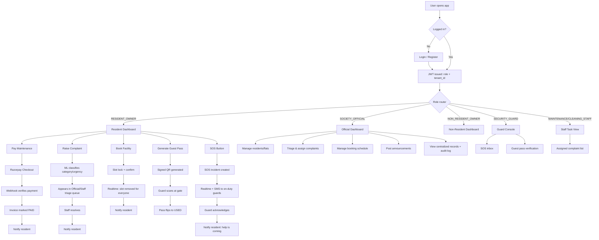

# Wireframes & App Workflow

Owner: Whole team (initial UX reference, primarily for Person A) · Parent doc: [00 — Architecture Overview](00-architecture-overview.md)

This is a **low-fidelity, text-based wireframe set** — good enough to agree on page structure and navigation before any pixel-level design work starts. It intentionally shows layout and content blocks, not colors/fonts/spacing (that's a later, separate UI-polish pass in Phase 3, see [00 §8](00-architecture-overview.md#8-build-phasing)). Screens are grouped by role, matching the routing table in [01 — Frontend Architecture §4](01-frontend-architecture.md#4-role-based-routing).

## 1. End-to-End App Workflow



Every branch that changes state (payment, complaint, booking, guest pass, SOS) writes an `AuditLog` row and fires a notification — this is the same flow described module-by-module in [02 — Backend Architecture](02-backend-architecture.md), shown here as one connected picture instead of split by epic.

## 2. Sitemap

```
/login, /register
/resident
 ├── /dashboard              (Story 5.1: payments + complaints + bookings in one view)
 ├── /maintenance            (invoice list, Pay Now, payment history)
 ├── /complaints             (raise + list + status timeline)
 ├── /bookings                (facility calendar, my bookings)
 ├── /guest-passes            (generate, history, QR display)
 └── /sos                     (SOS button + live status)
/official
 ├── /dashboard               (Story 5.2: centralized records)
 ├── /residents               (manage residents/flats)
 ├── /complaints/triage       (urgency-sorted queue)
 ├── /bookings/schedule       (shared schedule management)
 └── /announcements           (composer + feed)
/non-resident
 ├── /dashboard               (announcements + payment/complaint status, read-mostly)
 └── /guest-passes            (generate for their property)
/guard
 ├── /sos-inbox
 └── /verify-pass             (QR scanner)
/staff
 └── /my-tasks                 (assigned complaints)
```

## 3. Key Screen Wireframes

### 3.1 Login

```
┌──────────────────────────────────────┐
│              [ App Logo ]             │
│                                        │
│   Email     [_____________________]   │
│   Password  [_____________________]   │
│                                        │
│            [   Log In   ]             │
│                                        │
│   Don't have an account? Register     │
└──────────────────────────────────────┘
```

### 3.2 Resident Dashboard (Story 5.1)

```
┌───────────────────────────────────────────────────────────┐
│  [Logo]   Society: Sunrise Apartments        [🔔] [Avatar] │
├───────────────────────────────────────────────────────────┤
│  ┌─────────────┐ ┌─────────────┐ ┌─────────────┐          │
│  │ Dues: ₹4,500 │ │ Complaints:2 │ │ Bookings: 1 │  [SOS]  │
│  │ [Pay Now]    │ │ open         │ │ upcoming    │  button │
│  └─────────────┘ └─────────────┘ └─────────────┘          │
│                                                             │
│  Recent Activity                                            │
│  ─────────────────────────────────────────────────         │
│  • Complaint #114 "Plumbing" → IN_PROGRESS                 │
│  • Booking: Clubhouse, Sat 6-8pm → CONFIRMED                │
│  • Invoice Nov-2026 → PAID                                  │
│                                                             │
│  Announcements                                               │
│  ─────────────────────────────────────────────────         │
│  • Water supply maintenance on Sunday 9am-1pm                │
└───────────────────────────────────────────────────────────┘
```

### 3.3 Raise Complaint

```
┌──────────────────────────────────────┐
│  Raise a Complaint                    │
│                                        │
│  Description:                         │
│  [                                  ] │
│  [  (free text, multi-line)         ] │
│                                        │
│  Attach photo (optional): [Upload]    │
│                                        │
│           [ Submit Complaint ]        │
│                                        │
│  Note: category & urgency are         │
│  auto-detected — you don't pick them  │
└──────────────────────────────────────┘
```

### 3.4 Complaint List + Status Timeline

```
┌───────────────────────────────────────────────────┐
│  My Complaints                        [+ New]      │
│  ┌─────────────────────────────────────────────┐   │
│  │ #114  Plumbing   HIGH    IN_PROGRESS          │   │
│  │ #109  Electrical MEDIUM  RESOLVED             │   │
│  └─────────────────────────────────────────────┘   │
│                                                      │
│  Selected: #114                                     │
│  ● Raised          Nov 2, 10:03am                   │
│  ● Assigned to Maintenance Staff   Nov 2, 11:15am   │
│  ○ In Progress                                       │
│  ○ Resolved                                          │
└───────────────────────────────────────────────────┘
```

### 3.5 Facility Booking Calendar

```
┌───────────────────────────────────────────────────────┐
│  Book: Clubhouse ▾           Week of Nov 3 – Nov 9      │
│         Mon   Tue   Wed   Thu   Fri   Sat   Sun         │
│  9-11   [ ]   [ ]   [X]   [ ]   [ ]   [ ]   [ ]         │
│  11-1   [ ]   [X]   [ ]   [ ]   [X]   [ ]   [ ]         │
│  6-8    [ ]   [ ]   [ ]   [ ]   [ ]   [•]   [ ]         │
│                                                          │
│  [ ] available   [X] booked (by others)   [•] selected  │
│                                                          │
│                    [ Confirm Booking ]                   │
└───────────────────────────────────────────────────────┘
```
`[X]` slots update live across all connected clients the instant someone else confirms a booking (realtime `booking.slot_taken` event).

### 3.6 Generate Guest Pass

```
┌──────────────────────────────────────┐
│  Generate Guest Pass                  │
│                                        │
│  Visitor Name    [________________]   │
│  Visitor Phone   [________________]   │
│  Valid From      [____] Valid Until [____] │
│                                        │
│           [ Generate Pass ]           │
│                                        │
│  ┌───────────────┐                     │
│  │   [ QR CODE ]  │  Share via:         │
│  │                │  [WhatsApp] [Copy]  │
│  └───────────────┘                     │
└──────────────────────────────────────┘
```

### 3.7 SOS Button (Resident)

```
┌──────────────────────────────────────┐
│                                        │
│              ┌────────┐               │
│              │  SOS   │               │
│              │ (hold  │               │
│              │ 2 sec) │               │
│              └────────┘               │
│                                        │
│   Status: idle                        │
│   (after trigger →)                   │
│   Status: 🔴 Alert sent — waiting      │
│           for guard acknowledgment    │
│   (after ack →)                       │
│   Status: 🟢 Guard Ramesh is on the way │
└──────────────────────────────────────┘
```
Hold-to-trigger (not a single tap) is a deliberate anti-misfire safeguard for something this high-stakes.

### 3.8 Official Dashboard (Story 5.2)

```
┌───────────────────────────────────────────────────────────┐
│  Society Admin                              [🔔] [Avatar]  │
├───────────────────────────────────────────────────────────┤
│  ┌──────────────┐ ┌──────────────┐ ┌──────────────┐       │
│  │ Open          │ │ Dues Overdue  │ │ Pending       │       │
│  │ Complaints: 7 │ │ Flats: 3      │ │ Bookings: 2   │       │
│  └──────────────┘ └──────────────┘ └──────────────┘       │
│                                                             │
│  Complaint Triage (sorted by urgency)                       │
│  ─────────────────────────────────────────────────         │
│  🔴 #114 Plumbing     Flat B-204   [Assign ▾]              │
│  🟡 #115 Cleaning      Flat A-101   [Assign ▾]              │
│                                                             │
│  Recent Audit Log                                            │
│  ─────────────────────────────────────────────────         │
│  • Payment PAID — Flat C-303 — 2 min ago                     │
│  • Booking CONFIRMED — Clubhouse — 10 min ago                │
└───────────────────────────────────────────────────────────┘
```

### 3.9 Guard Console — SOS Inbox & Pass Verification

```
┌──────────────────────────────────────┐   ┌──────────────────────────────────┐
│  🔴 ACTIVE SOS                        │   │  Verify Guest Pass                │
│  Flat B-204 — raised 00:14 ago        │   │                                    │
│         [ Acknowledge ]               │   │   [ Scan QR Code ]                 │
│                                        │   │                                    │
│  Resolved Today                       │   │   Result: ✅ Valid — Visitor:      │
│  • Flat A-101 — 09:12am                │   │   Raj Kumar, Flat B-204            │
└──────────────────────────────────────┘   └──────────────────────────────────┘
```

### 3.10 Announcement Feed (Non-Resident Owner view, read-mostly)

```
┌──────────────────────────────────────┐
│  Announcements                        │
│  ─────────────────────────────────    │
│  📌 Nov 5 — Water supply maintenance   │
│  📌 Nov 1 — AGM scheduled for Nov 20    │
│                                        │
│  My Property: Flat B-204               │
│  Dues: ₹4,500 (due Nov 10)             │
│  Open Complaints: 1                    │
│  [ Generate Guest Pass ]               │
└──────────────────────────────────────┘
```

## 4. Common UI States (apply to every screen above)

- **Loading**: skeleton placeholders on cards/lists, never a blank white screen
- **Empty**: e.g. "No complaints yet — raise one to get started" with the primary action button visible, not just blank
- **Error**: inline message near the failed action (e.g. under the Pay Now button) showing the `requestId` so the failure can be traced to its server-side log entry, not a generic alert popup. (The `requestId` is delivered; forwarding it to Sentry is not.)
- **Offline (PWA)**: cached last-known dashboard data shown with a small "offline — showing cached data" banner, actions that require network are disabled rather than silently failing

## 5. From Wireframe to Build Order

These wireframes map directly onto the phasing in [00 — Architecture Overview §8](00-architecture-overview.md#8-build-phasing):

- **Phase 1 (MVP)**: Login, Resident Dashboard (basic), Maintenance (manual pay marking, no gateway yet), Raise/List Complaint (manual triage, no ML tag), Booking Calendar
- **Phase 2 (Full)**: Pay Now (Razorpay), ML-tagged triage queue, Guest Pass + QR, SOS flow, Official Dashboard, Announcement feed
- **Phase 3 (Polish)**: Guard Console polish, Non-Resident dashboard, empty/error/offline states hardened, visual design pass (color/type/spacing — this is where [frontend-design]-style polish work happens, deliberately kept out of this initial wireframe)
