# Design of Components

**Team 98 · Milestone 2 · Apartment Complex Management System**  
Parent doc: [00 — Architecture Overview](00-architecture-overview.md)

---

## 1. System-Level Component Diagram

The system is organised into five deployment units. Every arrow represents a real runtime communication path.

```mermaid
graph TD
    subgraph Client["Client (Browser / PWA)"]
        FE["React 18 PWA\n(Vite + TypeScript)"]
        SW["Service Worker\n(Push / Offline)"]
        FE --- SW
    end

    subgraph Backend["FastAPI API — Modular Monolith (Render)"]
        direction TB
        AUTH["auth router"]
        TENANT["tenants router"]
        USER["users + flats router"]
        MAINT["maintenance router"]
        COMP["complaints router"]
        BOOK["bookings router"]
        VIS["visitors router"]
        ANN["announcements router"]
        NOTIF["NotificationService"]
        AUDIT["AuditService"]
        RT["RealtimeGateway\n(WebSockets)"]
        MLC["MLClient"]
        ORM["SQLAlchemy Session\n(Tenant-scoped)"]
    end

    subgraph ML["ML Service — FastAPI (Render)"]
        CC["ComplaintClassifier"]
        PR["PaymentRiskScorer"]
        AS["ArtifactStore"]
        CC --- AS
        PR --- AS
    end

    subgraph Infra["Infrastructure"]
        REDIS["Redis (Upstash)\nCache · Locks · Job queue · WS Pub-Sub"]
        PG["PostgreSQL (Supabase)\n18 tables · Tenant isolation"]
        STOR["Supabase Storage\nQR images · Photos · ML artifacts"]
    end

    subgraph Ext["External Services"]
        RZP["Razorpay\n(Payments)"]
        SG["SendGrid\n(Email)"]
        TW["Twilio\n(SMS)"]
        SENTRY["Sentry\n(Error tracking)"]
    end

    FE -->|"REST + JWT"| AUTH
    FE -->|"REST + JWT"| MAINT
    FE -->|"REST + JWT"| COMP
    FE -->|"REST + JWT"| BOOK
    FE -->|"REST + JWT"| VIS
    FE -->|"REST + JWT"| ANN
    FE <-->|"WebSocket"| RT

    MAINT --> ORM
    COMP --> ORM
    BOOK --> ORM
    VIS --> ORM
    ANN --> ORM
    AUTH --> ORM
    USER --> ORM
    TENANT --> ORM
    AUDIT --> ORM
    NOTIF --> ORM

    ORM -->|"SQL via SQLAlchemy"| PG

    BOOK -->|"Redis lock on slot_id"| REDIS
    NOTIF -->|"queued jobs"| REDIS
    RT -->|"Redis pub/sub"| REDIS

    MAINT -->|"HTTP + shared secret"| MLC
    COMP -->|"HTTP + shared secret"| MLC
    MLC -->|"POST /complaints/classify\nPOST /payment-risk/score"| CC
    MLC --> PR

    MAINT -->|"Razorpay Orders API"| RZP
    RZP -->|"HMAC-verified confirmation"| MAINT

    NOTIF -->|"Web Push"| SW
    NOTIF -->|"Email"| SG
    NOTIF -->|"SMS SOS + critical"| TW

    AS -->|"model.pkl versioned"| STOR

    AUTH -.->|"error events"| SENTRY
```

---

## 2. Frontend Components

**Technology**: React 18 + TypeScript, Vite, Tailwind CSS, TanStack Query, Zustand, React Router, native WebSocket client, vite-plugin-pwa.

### 2.1 App Shell & Providers

| Component | Responsibility |
|---|---|
| `AppRouter` | Role-based route guard; reads JWT role from auth store; redirects unauthorized access |
| `AuthProvider` | Zustand store for auth session (access token, decoded claims, refresh logic) |
| `QueryClientProvider` | TanStack Query cache; configured with stale-time and retry policies |
| `SocketProvider` | Opens the WebSocket connection on login; server subscribes it to `tenant:{id}:user:{id}` and `tenant:{id}:role:{role}` channels |
| `ServiceWorker` | Registers Web Push subscription; handles offline caching of app shell |

### 2.2 Feature Components (by epic)

| Feature Folder | Pages / Components | Notes |
|---|---|---|
| `features/auth` | `LoginPage`, `RegisterPage`, `ForgotPassword` | Token storage, redirect-on-login |
| `features/dashboard` | `ResidentDashboard`, `OfficialDashboard`, `NonResidentDashboard` | Aggregated summary cards; pulls from multiple query hooks |
| `features/maintenance` | `InvoiceList`, `PayNowModal`, `PaymentHistory`, `InvoiceManagement` (official) | Razorpay `rzp.open()` client-side checkout embed |
| `features/complaints` | `RaiseComplaintForm`, `ComplaintList`, `StatusTimeline`, `TriageQueue` (official/staff) | Timeline driven by `ComplaintStatusHistory`; triage sorted by ML urgency |
| `features/bookings` | `FacilityCalendar` (slot grid), `MyBookings`, `ScheduleManagement` (official) | Live slot updates via `booking.slot_taken` socket event |
| `features/visitors` | `GenerateGuestPass`, `GuestPassHistory`, `QRDisplay`, `SOSButton`, `SOSInbox` (guard), `QRScanner` (guard) | Hold-to-trigger SOS anti-misfire; signed QR token display |
| `features/announcements` | `AnnouncementFeed`, `AnnouncementComposer` (official) | Audience-filtered feed |

### 2.3 Shared UI Components

| Component | Responsibility |
|---|---|
| `SkeletonCard` | Loading state placeholder — no blank white screens |
| `EmptyState` | Contextual empty-state with primary CTA |
| `ErrorMessage` | Inline error with `requestId` for support tracing |
| `OfflineBanner` | PWA offline indicator; disables network-dependent actions |
| `NotificationToast` | Real-time toast for SOS, booking, and complaint updates |
| `RoleGuard` | Wraps routes/components; renders nothing if role is not permitted |

### 2.4 API Client & Hook Layer

| Component | Responsibility |
|---|---|
| `src/api/generated/` | Auto-generated typed client from OpenAPI spec via `openapi-typescript-codegen` |
| `src/api/hooks/` | React Query hooks wrapping the generated client (e.g. `useInvoices()`, `useComplaints()`) |
| `src/hooks/useSocket.ts` | Centralised WebSocket event subscriptions with cleanup on unmount |
| `src/hooks/useAuth.ts` | Auth store selector + refresh token logic |

---

## 3. Backend Components (FastAPI Routers)

**Technology**: FastAPI (Python 3.11), SQLAlchemy 2.0 ORM, Alembic, Redis (Upstash), WebSockets — deployed as a modular monolith on Render.

Each epic follows the pattern: one `api/v1/*.py` router + its Pydantic schemas in `schemas.py` + its own test module. Shared concerns are injected per route with `Depends()`, so a route's auth, role and tenant requirements are readable directly from its signature.

| Router / Service | Routes (abbreviated) | Responsibilities | Dependencies |
|---|---|---|---|
| **auth** | `POST /auth/register`, `/auth/login`, `/auth/refresh`, `/auth/logout`, `GET /auth/me` | JWT issuing, rotating refresh tokens (hash-at-rest), PBKDF2 password hashing | `PyJWT`, `hashlib`, Session |
| **tenants** | `POST /tenants`, `GET /tenants`, `POST /flats`, `GET /flats`, `POST /flats/{id}/occupants`, `GET /users` | Society onboarding (SuperAdmin); flat registry, occupant links and directory (Official) | AuditService, Session |
| **maintenance** | `GET /maintenance/invoices`, `POST /maintenance/invoices`, `POST /maintenance/invoices/{id}/pay`, `POST /maintenance/invoices/{id}/payments/confirm`, `GET /maintenance/summary`, `GET /maintenance/flats/{id}/risk-score` | Invoice generation, gateway order creation, HMAC signature verification before settlement, read-time overdue evaluation, ML risk score | MLClient, NotificationService, AuditService, Session |
| **complaints** | `POST /complaints`, `GET /complaints`, `GET /complaints/{id}`, `PATCH /complaints/{id}/status`, `POST /complaints/{id}/assign` | Creation → ML classify (with fallback) → validated lifecycle transitions → history + AuditLog | MLClient, NotificationService, AuditService, Session |
| **bookings** | `POST /facilities`, `GET /facilities`, `POST /facilities/{id}/slots`, `GET /facilities/{id}/slots`, `POST /bookings`, `GET /bookings`, `POST /bookings/{id}/cancel` | Slot lock → confirmed-booking check → partial unique index as second defence; live availability | Redis (lock), NotificationService, AuditService, Session |
| **visitors** | `POST /visitors/guest-passes`, `GET /visitors/guest-passes`, `POST /visitors/guest-passes/{token}/verify`, `POST /visitors/guest-passes/{id}/revoke`, `POST /sos`, `GET /sos`, `POST /sos/{id}/acknowledge`, `POST /sos/{id}/resolve` | Random QR token generation; atomic single-use verification with reasoned rejections; SOS incident lifecycle | NotificationService, AuditService, Session |
| **announcements** | `POST /announcements`, `GET /announcements`, `GET /notifications`, `POST /notifications/{id}/read` | Audience-targeted publishing; per-user in-app notification feed | NotificationService, AuditService, Session |
| **NotificationService** | Internal `notify()` / `notify_many()` — no public route | Resolves channels per notification type; dispatches each independently; always writes the `Notification` row for the in-app feed | Redis queue, Web Push (VAPID), SendGrid, Twilio, Session |
| **AuditService** | Internal `record()` — no public route | Append-only `AuditLog` writer; called on every state-changing action | Session |
| **RealtimeGateway** | WS events: `sos.raised`, `sos.acknowledged`, `complaint.status_changed`, `booking.slot_taken` | JWT-verified connection; server-assigned channel subscription; Redis pub/sub for multi-instance scaling | Redis pub/sub |
| **MLClient** | Internal HTTP calls only | Wraps the ML service endpoints; 2 s timeout, keyword fallback on error or low confidence | ML Service |
| **Session** | Internal ORM layer | Request-scoped SQLAlchemy session; tenant-scoped queries filter on the `get_tenant_id` dependency | Supabase Postgres |

### 3.1 Cross-Cutting / Common Layer

| Component | Responsibility |
|---|---|
| `get_current_user` | Verifies the JWT access token and resolves the caller on every protected route |
| `require_roles(...)` | Route dependency checking the JWT role claim against the roles a route allows |
| `get_tenant_id` | Supplies the society scope from the JWT claim; every tenant-scoped query filters on it |
| Rate-limit middleware | Redis-backed; tighter limits on `/auth/*` and `/sos` |
| Exception handlers | Map application errors, framework errors, validation failures and unhandled exceptions to `{ statusCode, error, message, requestId }` |
| Request-id middleware | Generates a UUID per request; returned as `X-Request-Id` and included in logs and error reports |

---

## 4. ML Service Components

**Technology**: Python, FastAPI, scikit-learn (TF-IDF + Logistic Regression / Gradient Boosting), deployed separately on Render.

| Component | File | Responsibility |
|---|---|---|
| **FastAPI App** | `app/main.py` | Entry point; mounts routers; shared-secret auth middleware (`X-Internal-Secret` header) |
| **Complaint Classifier** | `app/complaints/classify.py` | `POST /complaints/classify` — TF-IDF vectorise → LogReg predict → return `{category, urgency, confidence}` |
| **Complaint Trainer** | `app/complaints/train.py` | Load labeled data → train → evaluate macro-F1 → save `model.pkl` + metadata JSON |
| **Payment Risk Scorer** | `app/payment_risk/score.py` | `POST /payment-risk/score` — feature vector → GradientBoosting predict → return `{risk_score}` |
| **Payment Risk Trainer** | `app/payment_risk/train.py` | Load invoice/payment history → engineer features → train → evaluate ROC-AUC → save artifact |
| **Artifact Store** | `app/common/artifact_store.py` | Load/save `model.pkl` and metadata to Supabase Storage; versioned by timestamp |

---

## 5. Infrastructure Components

| Component | Provider | Role |
|---|---|---|
| **PostgreSQL** | Supabase (free tier) | Primary data store; 18 tables; partial unique indexes; tenant isolation scoped from the JWT claim |
| **Supabase Storage** | Supabase | Object storage for complaint photos, guest-pass QR images, ML model artifacts |
| **Redis — Cache** | Upstash (free tier) | Short-lived caching (e.g. facility slot availability) |
| **Redis — Locks** | Upstash | `SET NX EX` distributed lock keyed on `slot_id` to prevent double-booking race condition |
| **Redis — Job Queue** | Upstash | Notification job queue; decouples slow channel dispatch from the HTTP request lifecycle |
| **Redis — Pub/Sub** | Upstash | Allows WebSocket events to fan out across multiple Render instances |
| **Razorpay** | External | Payment gateway (test/sandbox mode); order creation API + HMAC-verified confirmation |
| **SendGrid** | External | Transactional email for payment due/overdue notices |
| **Twilio** | External | SMS for SOS alerts and payment-critical notices |
| **Web Push (VAPID)** | Browser standard | In-browser push for all notification types; subscription stored per user |
| **Sentry** | External | Error tracking; `requestId` links frontend errors to server-side traces |

---

## 6. Component Interaction Summary

| Interaction | From → To | Protocol | Notes |
|---|---|---|---|
| User authentication | React PWA → auth router | REST HTTPS | Returns a JWT access token + a rotating refresh token |
| All API calls | React PWA → FastAPI routers | REST + `Bearer <JWT>` | Auth, role and tenant dependencies applied on every route |
| Real-time updates | React PWA ↔ RealtimeGateway | WebSocket | JWT verified on connection; channels assigned server-side |
| Push notifications | NotificationService → Service Worker | Web Push (VAPID) | Via stored browser subscription |
| ML complaint classification | complaints router → MLClient → ML Service | Internal HTTP + shared secret | 2 s timeout; keyword fallback, flagged for manual triage |
| ML payment risk scoring | maintenance router → MLClient → ML Service | Internal HTTP + shared secret | Periodic; result cached in `PaymentRiskScore` |
| Booking race-safety lock | bookings router → Redis | Redis `SET NX EX` | Released after DB write; partial unique index is second defence |
| Notification dispatch | NotificationService → Redis queue | Queued job | Workers dispatch to Push / SendGrid / Twilio independently |
| Event fan-out | RealtimeGateway → Redis pub/sub | Redis channels | Enables multi-instance horizontal scale |
| Payment order creation | maintenance router → Razorpay API | HTTPS | Returns `order_id` to frontend |
| Payment settlement | Client → maintenance router | HTTPS (HMAC verified) | Signature checked before the invoice is flipped to PAID |
| DB queries | All routers → SQLAlchemy Session | SQLAlchemy ORM (in-process) | Tenant-scoped queries filter on `get_tenant_id` |
| ORM → Database | Session → Supabase PostgreSQL | Postgres wire protocol | Connection pool managed by the SQLAlchemy engine |
| ML artifact persistence | ArtifactStore → Supabase Storage | HTTPS | Versioned by timestamp; reloaded on service restart |
| Error reporting | Any component → Sentry | HTTPS | `requestId` correlates frontend + backend events |
