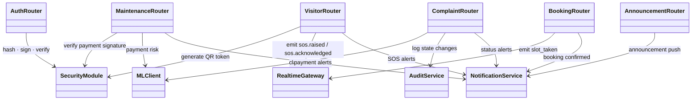

# Class Diagram

**Team 98 · Milestone 2 · Apartment Complex Management System**  
Parent doc: [00 — Architecture Overview](00-architecture-overview.md)

This document covers two levels of the class model:

1. **Domain Entity Classes** — the core data objects of the system (maps to DB tables)
2. **Service Classes** — the backend business logic components (FastAPI routers and services)

---

## 1. Enumerations

```mermaid
classDiagram
    class Role {
        <<enumeration>>
        SUPER_ADMIN
        SOCIETY_OFFICIAL
        RESIDENT_OWNER
        NON_RESIDENT_OWNER
        SECURITY_GUARD
        MAINTENANCE_STAFF
        CLEANING_STAFF
        SERVICE_PROVIDER
    }

    class OccupancyType {
        <<enumeration>>
        OWNER_OCCUPIED
        RENTED
        VACANT
    }

    class Relation {
        <<enumeration>>
        OWNER
        RESIDENT_TENANT
    }

    class InvoiceStatus {
        <<enumeration>>
        PENDING
        PAID
        OVERDUE
    }

    class ComplaintStatus {
        <<enumeration>>
        OPEN
        IN_PROGRESS
        RESOLVED
        CLOSED
    }

    class ComplaintCategory {
        <<enumeration>>
        PLUMBING
        ELECTRICAL
        STRUCTURAL
        SECURITY
        CLEANING
        GENERAL
    }

    class UrgencyLevel {
        <<enumeration>>
        LOW
        MEDIUM
        HIGH
    }

    class BookingStatus {
        <<enumeration>>
        CONFIRMED
        CANCELLED
    }

    class GuestPassStatus {
        <<enumeration>>
        ACTIVE
        USED
        EXPIRED
        REVOKED
    }

    class SOSStatus {
        <<enumeration>>
        OPEN
        ACKNOWLEDGED
        RESOLVED
    }

    class Audience {
        <<enumeration>>
        ALL
        RESIDENTS
        NON_RESIDENT_OWNERS
        STAFF
    }

    class NotificationChannel {
        <<enumeration>>
        IN_APP
        PUSH
        EMAIL
        SMS
    }

    class NotificationType {
        <<enumeration>>
        SOS_RAISED
        PAYMENT_DUE_SOON
        PAYMENT_OVERDUE
        COMPLAINT_STATUS_CHANGED
        BOOKING_CONFIRMED
        ANNOUNCEMENT_POSTED
    }
```

---

## 2. Domain Entity Class Diagram

---

## 3. Service Class Diagram

```mermaid
classDiagram
    direction LR

    class AuthRouter {
        -Session db
        +register(payload RegisterRequest) UserResponse
        +login(payload LoginRequest) TokenResponse
        +refresh(payload RefreshRequest) TokenResponse
        +logout(payload RefreshRequest) MessageResponse
        +me() UserResponse
        -issue_tokens(user User) TokenResponse
    }

    class SecurityModule {
        +hash_password(plain str) str
        +verify_password(plain, encoded str) bool
        +create_access_token(user_id, tenant_id, role) str
        +create_refresh_token(user_id str) tuple
        +decode_token(token str) dict
        +hash_token(token str) str
        +generate_qr_token() str
        +sign_payload(payload, secret str) str
        +verify_signature(payload, sig, secret) bool
    }

    class TenantRouter {
        -Session db
        +create_tenant(payload TenantCreate) TenantResponse
        +list_tenants() list~TenantResponse~
        +create_flat(payload FlatCreate) FlatResponse
        +list_flats(block str) list~FlatResponse~
        +assign_occupant(flat_id, payload) MessageResponse
        +list_users(role Role) list~UserResponse~
    }

    class MaintenanceRouter {
        -Session db
        -MLClient ml_client
        -NotificationService notifications
        +create_invoice(payload InvoiceCreate) InvoiceResponse
        +list_invoices(status, flat_id, period) list~InvoiceResponse~
        +get_invoice(invoice_id str) InvoiceResponse
        +create_payment_order(invoice_id str) PaymentOrderResponse
        +confirm_payment(invoice_id, payload) PaymentResponse
        +summary() MaintenanceSummaryResponse
        +risk_score(flat_id, period) RiskScoreResponse
        -refresh_overdue(invoices list) void
        -assert_can_view(user, invoice) void
    }

    class ComplaintRouter {
        -Session db
        -MLClient ml_client
        -NotificationService notifications
        -AuditService audit
        +create_complaint(payload ComplaintCreate) ComplaintResponse
        +list_complaints(status, assigned_to_me) list~ComplaintResponse~
        +get_complaint(complaint_id str) ComplaintResponse
        +update_status(complaint_id, payload) ComplaintResponse
        +assign_complaint(complaint_id, payload) ComplaintResponse
    }

    class BookingRouter {
        -Session db
        -Redis redis
        -NotificationService notifications
        +create_facility(payload FacilityCreate) FacilityResponse
        +list_facilities() list~FacilityResponse~
        +create_slot(facility_id, payload) SlotResponse
        +list_slots(facility_id, date) list~SlotResponse~
        +create_booking(payload BookingCreate) BookingResponse
        +list_bookings(mine bool) list~BookingResponse~
        +cancel_booking(booking_id str) BookingResponse
        -confirmed_booking(slot_id str) Booking
    }

    class VisitorRouter {
        -Session db
        -NotificationService notifications
        +create_guest_pass(payload GuestPassCreate) GuestPassResponse
        +list_guest_passes(status) list~GuestPassResponse~
        +verify_guest_pass(qr_token str) GuestPassVerifyResponse
        +revoke_guest_pass(pass_id str) GuestPassResponse
        +raise_sos(payload SOSCreate) SOSResponse
        +list_sos(status) list~SOSResponse~
        +acknowledge_sos(incident_id str) SOSResponse
        +resolve_sos(incident_id str) SOSResponse
    }

    class AnnouncementRouter {
        -Session db
        -NotificationService notifications
        +create_announcement(payload AnnouncementCreate) AnnouncementResponse
        +list_announcements() list~AnnouncementResponse~
        +list_notifications(unread_only bool) list~NotificationResponse~
        +mark_read(notification_id str) NotificationResponse
        -visible_to(audience, role str) bool
    }

    class NotificationService {
        -Session db
        -Redis queue
        +notify(tenant_id, user_id, type, title, body) Notification
        +notify_many(tenant_id, user_ids, type, title, body) list
        -CHANNELS dict
        -send_push(subscription, payload) void
        -send_email(to, subject, body) void
        -send_sms(phone, message) void
    }

    class AuditService {
        -Session db
        +record(tenant_id, actor, action, entity_type, entity_id, detail) AuditLog
    }

    class RealtimeGateway {
        -WebSocket server
        -Redis pubsub
        +handle_connection(websocket) void
        +emit_sos_raised(tenant_id, incident) void
        +emit_sos_acknowledged(tenant_id, incident) void
        +emit_complaint_status_changed(tenant_id, complaint) void
        +emit_booking_slot_taken(tenant_id, slot_id) void
        -verify_jwt(token str) dict
        -subscribe_channels(ws, tenant_id, user_id, role) void
    }

    class MLClient {
        +classify_complaint(description str) Classification
        +score_payment_risk(on_time_ratio, overdue_count, months) float
        -rule_based(description str) Classification
    }

    class Dependencies {
        +get_db() Session
        +get_current_user() CurrentUser
        +require_roles(roles) CurrentUser
        +get_tenant_id() str
    }

    class Session {
        -Engine engine
        +query() Result
        +commit() void
        +close() void
    }

    %% Dependencies
    AuthRouter --> Session
    AuthRouter --> SecurityModule
    TenantRouter --> Session
    TenantRouter --> AuditService
    MaintenanceRouter --> Session
    MaintenanceRouter --> SecurityModule
    MaintenanceRouter --> MLClient
    MaintenanceRouter --> NotificationService
    MaintenanceRouter --> AuditService
    ComplaintRouter --> Session
    ComplaintRouter --> MLClient
    ComplaintRouter --> NotificationService
    ComplaintRouter --> AuditService
    BookingRouter --> Session
    BookingRouter --> RealtimeGateway
    BookingRouter --> NotificationService
    BookingRouter --> AuditService
    VisitorRouter --> Session
    VisitorRouter --> SecurityModule
    VisitorRouter --> RealtimeGateway
    VisitorRouter --> NotificationService
    VisitorRouter --> AuditService
    AnnouncementRouter --> Session
    AnnouncementRouter --> NotificationService
    AnnouncementRouter --> AuditService
    NotificationService --> Session
    AuditService --> Session
    Dependencies --> Session
    Dependencies --> SecurityModule
    AuthRouter ..> Dependencies
    MaintenanceRouter ..> Dependencies
    ComplaintRouter ..> Dependencies
    BookingRouter ..> Dependencies
    VisitorRouter ..> Dependencies
    AnnouncementRouter ..> Dependencies
    TenantRouter ..> Dependencies
```

---

## 4. Key Design Patterns Used

| Pattern                     | Where applied                                                                 | Purpose                                                                                |
| --------------------------- | ----------------------------------------------------------------------------- | -------------------------------------------------------------------------------------- |
| **Repository / ORM**        | Request-scoped SQLAlchemy `Session` supplied by `get_db()`                    | Abstracts DB access; tenant-scoped queries filter on the `get_tenant_id` dependency    |
| **Dependency Injection**    | FastAPI `Depends()` on every route                                            | A route's auth, role and tenant requirements are readable from its own signature       |
| **Strategy**                | `NotificationService` — `CHANNELS` map per notification type                  | Channels resolved at runtime without conditionals scattered across callers             |
| **Facade**                  | `MLClient`                                                                    | Single, clean interface to the ML service; hides timeout + fallback logic from callers |
| **Observer / Event-driven** | `RealtimeGateway` emitting WebSocket events                                   | Decouples booking/SOS/complaint state changes from client update logic                 |
| **Queue / Worker**          | `NotificationService` + Redis job queue                                       | Decouples slow I/O (SMS, email) from the synchronous HTTP request lifecycle            |
| **Guard**                   | `get_current_user`, `require_roles(...)`, `get_tenant_id`                     | Cross-cutting security applied declaratively as route dependencies                     |
| **Fallback / Null Object**  | `MLClient._rule_based()`                                                      | Keeps system functional when ML service is degraded or offline                         |
| **State machine**           | Complaint `_ALLOWED_TRANSITIONS` map                                          | Lifecycle moves are validated centrally, so the audit trail cannot be short-circuited  |

---

## 5. Relationships at a Glance

