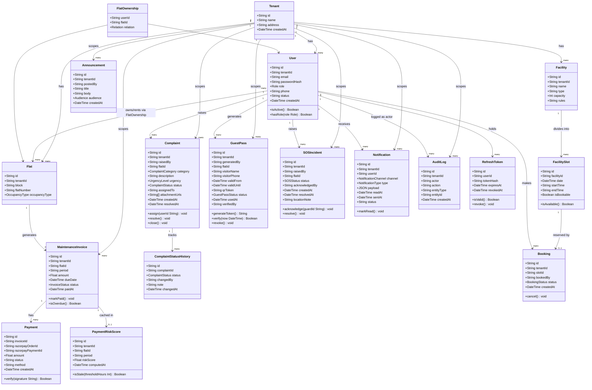
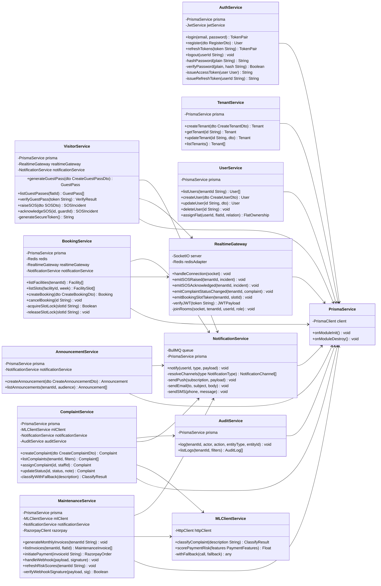
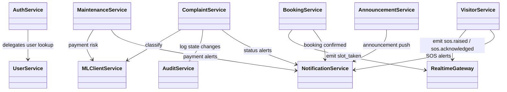

# Class Diagram

**Team 98 · Milestone 2 · Apartment Complex Management System**  
Parent doc: [00 — Architecture Overview](00-architecture-overview.md)

This document covers two levels of the class model:

1. **Domain Entity Classes** — the core data objects of the system (maps to DB tables)
2. **Service Classes** — the backend business logic components (NestJS services)

---

## 1. Enumerations

```mermaid
classDiagram
    class Role {
        <<enumeration>>
        SUPER_ADMIN
        SOCIETY_OFFICIAL
        RESIDENT_OWNER
        NON_RESIDENT_OWNER
        SECURITY_GUARD
        MAINTENANCE_STAFF
        CLEANING_STAFF
        SERVICE_PROVIDER
    }

    class OccupancyType {
        <<enumeration>>
        OWNER_OCCUPIED
        RENTED
        VACANT
    }

    class Relation {
        <<enumeration>>
        OWNER
        RESIDENT_TENANT
    }

    class InvoiceStatus {
        <<enumeration>>
        PENDING
        PAID
        OVERDUE
    }

    class ComplaintStatus {
        <<enumeration>>
        OPEN
        IN_PROGRESS
        RESOLVED
        CLOSED
    }

    class ComplaintCategory {
        <<enumeration>>
        PLUMBING
        ELECTRICAL
        STRUCTURAL
        SECURITY
        CLEANING
        GENERAL
    }

    class UrgencyLevel {
        <<enumeration>>
        LOW
        MEDIUM
        HIGH
    }

    class BookingStatus {
        <<enumeration>>
        CONFIRMED
        CANCELLED
    }

    class GuestPassStatus {
        <<enumeration>>
        ACTIVE
        USED
        EXPIRED
        REVOKED
    }

    class SOSStatus {
        <<enumeration>>
        OPEN
        ACKNOWLEDGED
        RESOLVED
    }

    class Audience {
        <<enumeration>>
        ALL
        RESIDENTS
        NON_RESIDENT_OWNERS
        STAFF
    }

    class NotificationChannel {
        <<enumeration>>
        IN_APP
        PUSH
        EMAIL
        SMS
    }

    class NotificationType {
        <<enumeration>>
        SOS_RAISED
        PAYMENT_DUE_SOON
        PAYMENT_OVERDUE
        COMPLAINT_STATUS_CHANGED
        BOOKING_CONFIRMED
        ANNOUNCEMENT_POSTED
    }
```

---

## 2. Domain Entity Class Diagram

---

## 3. Service Class Diagram

---

## 4. Key Design Patterns Used

| Pattern                     | Where applied                                                                 | Purpose                                                                                |
| --------------------------- | ----------------------------------------------------------------------------- | -------------------------------------------------------------------------------------- |
| **Repository / ORM**        | `PrismaService` injected into all services                                    | Abstracts DB access; tenant filter auto-injected via Prisma Client Extension           |
| **Strategy**                | `NotificationService` — channel selection per notification type               | Channels resolved at runtime without conditionals scattered across callers             |
| **Facade**                  | `MLClientService`                                                             | Single, clean interface to the ML service; hides timeout + fallback logic from callers |
| **Observer / Event-driven** | `RealtimeGateway` emitting Socket.IO events                                   | Decouples booking/SOS/complaint state changes from client update logic                 |
| **Queue / Worker**          | `NotificationService` + BullMQ                                                | Decouples slow I/O (SMS, email) from the synchronous HTTP request lifecycle            |
| **Guard / Interceptor**     | `JwtAuthGuard`, `RolesGuard`, `TenantScopedGuard`, `TenantContextInterceptor` | Cross-cutting security applied declaratively at the controller level                   |
| **Fallback / Null Object**  | `MLClientService.withFallback()`                                              | Keeps system functional when ML service is degraded or offline                         |

---

## 5. Relationships at a Glance

