# Database Design Diagram

**Team 98 · Milestone 2 · Apartment Complex Management System**  
Parent doc: [03 — Database Architecture](03-database-architecture.md)

---

## 1. Entity-Relationship Diagram

> **Notation**: `||--||` = one-to-one, `||--o{` = one-to-many (zero or more), `}o--||` = many-to-one.  
> All FK columns that carry `tenant_id` are marked `FK` in the column list. Primary keys are marked `PK`.

```mermaid
erDiagram

    Tenant {
        string id PK
        string name
        string address
        datetime createdAt
    }

    User {
        string id PK
        string tenantId FK
        string email
        string passwordHash
        string role
        string phone
        string status
        datetime createdAt
    }

    RefreshToken {
        string id PK
        string userId FK
        string tokenHash
        datetime expiresAt
        datetime revokedAt
    }

    Flat {
        string id PK
        string tenantId FK
        string block
        string flatNumber
        string occupancyType
    }

    FlatOwnership {
        string userId FK
        string flatId FK
        string relation
    }

    MaintenanceInvoice {
        string id PK
        string tenantId FK
        string flatId FK
        string period
        float amount
        datetime dueDate
        string status
        datetime paidAt
    }

    Payment {
        string id PK
        string invoiceId FK
        string razorpayOrderId
        string razorpayPaymentId
        float amount
        string status
        string method
        datetime createdAt
    }

    PaymentRiskScore {
        string id PK
        string tenantId FK
        string flatId FK
        string period
        float riskScore
        datetime computedAt
    }

    Complaint {
        string id PK
        string tenantId FK
        string raisedBy FK
        string flatId FK
        string category
        string description
        string urgency
        string status
        string assignedTo FK
        string attachmentUrls
        datetime createdAt
        datetime resolvedAt
    }

    ComplaintStatusHistory {
        string id PK
        string complaintId FK
        string status
        string changedBy FK
        string note
        datetime changedAt
    }

    Facility {
        string id PK
        string tenantId FK
        string name
        string type
        int capacity
        string rules
    }

    FacilitySlot {
        string id PK
        string facilityId FK
        datetime date
        string startTime
        string endTime
        boolean isBookable
    }

    Booking {
        string id PK
        string tenantId FK
        string slotId FK
        string bookedBy FK
        string status
        datetime createdAt
    }

    GuestPass {
        string id PK
        string tenantId FK
        string generatedBy FK
        string flatId FK
        string visitorName
        string visitorPhone
        datetime validFrom
        datetime validUntil
        string qrToken
        string status
        datetime usedAt
        string verifiedBy FK
    }

    SOSIncident {
        string id PK
        string tenantId FK
        string raisedBy FK
        string flatId FK
        string status
        string acknowledgedBy FK
        datetime createdAt
        datetime resolvedAt
        string locationNote
    }

    Announcement {
        string id PK
        string tenantId FK
        string postedBy FK
        string title
        string body
        string audience
        datetime createdAt
    }

    Notification {
        string id PK
        string tenantId FK
        string userId FK
        string channel
        string type
        json payload
        datetime readAt
        datetime sentAt
        string status
    }

    AuditLog {
        string id PK
        string tenantId FK
        string actor FK
        string action
        string entityType
        string entityId
        datetime createdAt
    }

    %% Tenant scoping (one tenant → many rows)
    Tenant ||--o{ User : "has"
    Tenant ||--o{ Flat : "has"
    Tenant ||--o{ MaintenanceInvoice : "scopes"
    Tenant ||--o{ Complaint : "scopes"
    Tenant ||--o{ Facility : "has"
    Tenant ||--o{ GuestPass : "scopes"
    Tenant ||--o{ SOSIncident : "scopes"
    Tenant ||--o{ Announcement : "scopes"
    Tenant ||--o{ Notification : "scopes"
    Tenant ||--o{ AuditLog : "scopes"

    %% Auth
    User ||--o{ RefreshToken : "holds"

    %% Flat ownership (many-to-many join)
    User ||--o{ FlatOwnership : "linked via"
    Flat ||--o{ FlatOwnership : "linked via"

    %% Maintenance
    Flat ||--o{ MaintenanceInvoice : "billed by"
    MaintenanceInvoice ||--o{ Payment : "settled by"
    MaintenanceInvoice ||--o| PaymentRiskScore : "risk-scored in"

    %% Complaints
    User ||--o{ Complaint : "raises"
    Complaint ||--o{ ComplaintStatusHistory : "tracks via"

    %% Booking
    Facility ||--o{ FacilitySlot : "divided into"
    FacilitySlot ||--o| Booking : "reserved by"
    User ||--o{ Booking : "makes"

    %% Visitor & SOS
    User ||--o{ GuestPass : "generates"
    Flat ||--o{ GuestPass : "for"
    User ||--o{ SOSIncident : "raises"
    Flat ||--o{ SOSIncident : "at"

    %% Announcements
    User ||--o{ Announcement : "posts"

    %% Notifications & Audit
    User ||--o{ Notification : "receives"
    User ||--o{ AuditLog : "actor in"
```



---

## 2. Table Inventory

| # | Table | Rows owned by | Tenant-scoped | Notes |
|---|---|---|---|---|
| 1 | `Tenant` | SuperAdmin | No (it IS the tenant) | Platform-level; not tenant-scoped itself |
| 2 | `User` | Society Official / SuperAdmin | ✅ | Unique `(tenant_id, email)` |
| 3 | `RefreshToken` | Auth system | No (user-scoped) | Token hash only; never the raw token |
| 4 | `Flat` | Society Official | ✅ | Unique `(tenant_id, block, flat_number)` |
| 5 | `FlatOwnership` | Society Official | No (join table) | FK to User + Flat; composite PK |
| 6 | `MaintenanceInvoice` | Maintenance system (cron) | ✅ | Unique `(tenant_id, flat_id, period)` |
| 7 | `Payment` | Razorpay webhook | No (invoice-scoped) | Append-only payment record |
| 8 | `PaymentRiskScore` | ML scoring job | ✅ | One per flat per period; refreshed periodically |
| 9 | `Complaint` | Resident | ✅ | `assigned_to` is nullable until triage |
| 10 | `ComplaintStatusHistory` | Backend on every status change | No (complaint-scoped) | Append-only history; never updated |
| 11 | `Facility` | Society Official | ✅ | e.g. Clubhouse, Swimming Pool |
| 12 | `FacilitySlot` | Society Official / cron | No (facility-scoped) | `is_bookable` flag allows admin blackouts |
| 13 | `Booking` | Resident | ✅ | Partial unique index prevents double-booking |
| 14 | `GuestPass` | Resident / Non-Resident Owner | ✅ | `qr_token` globally unique |
| 15 | `SOSIncident` | Resident | ✅ | `acknowledged_by` nullable until guard responds |
| 16 | `Announcement` | Society Official | ✅ | Audience-filtered on read |
| 17 | `Notification` | NotificationModule worker | ✅ | Includes in-app feed records |
| 18 | `AuditLog` | Any module on state change | ✅ | Append-only; never updated or deleted |

---

## 3. Constraints & Unique Indexes

| Table | Constraint | Type | Purpose |
|---|---|---|---|
| `User` | `UNIQUE (tenant_id, email)` | Unique Index | Tenant-scoped email uniqueness; also the login lookup index |
| `Flat` | `UNIQUE (tenant_id, block, flat_number)` | Unique Index | No duplicate flat numbers per society |
| `MaintenanceInvoice` | `UNIQUE (tenant_id, flat_id, period)` | Unique Index | Exactly one invoice per flat per month |
| `Booking` | `UNIQUE (slot_id) WHERE status = 'CONFIRMED'` | Partial Unique Index | DB-level double-booking prevention (second defence after Redis lock) |
| `GuestPass` | `UNIQUE (qr_token)` | Unique Index | Guard-side scan lookup; globally unique across all tenants |
| `MaintenanceInvoice.status` | `CHECK (status IN ('PENDING','PAID','OVERDUE'))` | Check constraint | Enforces valid enum values at DB level |
| `FlatOwnership` | `PRIMARY KEY (user_id, flat_id)` | Composite PK | Prevents duplicate ownership records |
| `AuditLog` | No UPDATE or DELETE permission | Row-level policy | Enforced via Postgres RLS / service layer; append-only guarantee |

---

## 4. Index Strategy

| Table | Index | Rationale |
|---|---|---|
| `User` | `(tenant_id, email)` unique | Login lookup; tenant-scoped email uniqueness |
| `Flat` | `(tenant_id, block, flat_number)` unique | Flat lookup and uniqueness |
| `MaintenanceInvoice` | `(tenant_id, flat_id, period)` unique | One invoice per flat per period; fast per-flat history query |
| `MaintenanceInvoice` | `(tenant_id, status)` | Dashboard overdue count, official view |
| `Booking` | `(slot_id) WHERE status='CONFIRMED'` partial unique | Double-booking prevention at DB level |
| `Booking` | `(tenant_id, booked_by)` | My bookings list |
| `Complaint` | `(tenant_id, status, urgency)` | Triage queue query (officials/staff view), sorted by urgency |
| `Complaint` | `(tenant_id, raised_by)` | Resident's own complaint list |
| `GuestPass` | `(qr_token)` unique | O(1) guard-side scan lookup |
| `GuestPass` | `(tenant_id, flat_id, status)` | Active passes for a flat |
| `SOSIncident` | `(tenant_id, status)` | Open/active SOS inbox for guards |
| `AuditLog` | `(tenant_id, entity_type, entity_id)` | "Show history for this record" queries |
| `Notification` | `(tenant_id, user_id, read_at)` | Unread notification count + in-app feed |

---

## 5. Enum Reference

| Enum | Values | Used in table(s) |
|---|---|---|
| `Role` | `SUPER_ADMIN`, `SOCIETY_OFFICIAL`, `RESIDENT_OWNER`, `NON_RESIDENT_OWNER`, `SECURITY_GUARD`, `MAINTENANCE_STAFF`, `CLEANING_STAFF`, `SERVICE_PROVIDER` | `User.role` |
| `OccupancyType` | `OWNER_OCCUPIED`, `RENTED`, `VACANT` | `Flat.occupancyType` |
| `Relation` | `OWNER`, `RESIDENT_TENANT` | `FlatOwnership.relation` |
| `InvoiceStatus` | `PENDING`, `PAID`, `OVERDUE` | `MaintenanceInvoice.status` |
| `ComplaintStatus` | `OPEN`, `IN_PROGRESS`, `RESOLVED`, `CLOSED` | `Complaint.status`, `ComplaintStatusHistory.status` |
| `ComplaintCategory` | `PLUMBING`, `ELECTRICAL`, `STRUCTURAL`, `SECURITY`, `CLEANING`, `GENERAL` | `Complaint.category` |
| `UrgencyLevel` | `LOW`, `MEDIUM`, `HIGH` | `Complaint.urgency` |
| `BookingStatus` | `CONFIRMED`, `CANCELLED` | `Booking.status` |
| `GuestPassStatus` | `ACTIVE`, `USED`, `EXPIRED`, `REVOKED` | `GuestPass.status` |
| `SOSStatus` | `OPEN`, `ACKNOWLEDGED`, `RESOLVED` | `SOSIncident.status` |
| `Audience` | `ALL`, `RESIDENTS`, `NON_RESIDENT_OWNERS`, `STAFF` | `Announcement.audience` |
| `NotificationChannel` | `IN_APP`, `PUSH`, `EMAIL`, `SMS` | `Notification.channel` |
| `NotificationType` | `SOS_RAISED`, `PAYMENT_DUE_SOON`, `PAYMENT_OVERDUE`, `COMPLAINT_STATUS_CHANGED`, `BOOKING_CONFIRMED`, `ANNOUNCEMENT_POSTED` | `Notification.type` |

---

## 6. Tenant Isolation

Every table marked ✅ in the Table Inventory carries a non-nullable `tenant_id` column. Two enforcement layers guarantee cross-tenant data never leaks:

**Layer 1 — Application (`get_tenant_id` dependency)**  
The society scope is resolved once per request by a FastAPI dependency that reads the `tenant_id` claim from the decoded JWT. Because it is a declared dependency, a route that touches tenant-scoped data states its scope in its own signature, and every tenant-scoped query filters on that value. The scope is never taken from a request body or query parameter, so a caller cannot reach another society's data by editing a payload.

**Layer 2 — Database (Composite Indexes)**  
All performance indexes are prefixed `(tenant_id, ...)`. A raw query that omitted the tenant filter would still be structurally unusual and trivially catchable in code review.

**Layer 3 — Tests**  
A dedicated suite attempts every cross-society access path — invoice, complaint, booking, guest pass, announcement — using a token belonging to a *different* society, which is the realistic shape of the attack. Isolation is enforced by tests rather than left as a convention.

```
┌─────────────────────────────────────────────────────────────────────┐
│  HTTP Request                                                         │
│    JWT verified → tenant_id claim extracted by get_tenant_id()       │
│    ↓                                                                  │
│  Router                                                               │
│    every tenant-scoped query filters WHERE tenant_id = <scope>       │
│    ↓                                                                  │
│  PostgreSQL                                                           │
│    composite index (tenant_id, ...) ensures efficient, isolated query │
└─────────────────────────────────────────────────────────────────────┘
```

Cross-tenant reads return **404, not 403** — confirming a record exists would itself leak that another society holds that id.

---

## 7. Migration & Seeding Strategy

| Environment | Tool | Approach |
|---|---|---|
| **Local dev / tests** | `Base.metadata.create_all` on SQLite | No database server needed; the project clones and runs immediately |
| **CI** | `alembic upgrade head` | Ephemeral Postgres service container; migrations run before the integration suite |
| **Production** | `alembic upgrade head` (GitHub Actions deploy step) | Never autogenerate against prod; revisions committed and reviewed in PR |
| **Seeding** | `app/db/seed.py` | Creates a demo society with flats, a user per role, invoices, a complaint, facilities, slots and an announcement. Idempotent — does nothing if a society already exists |

> **Current state**: the schema is created from the SQLAlchemy model metadata for local and test runs. Alembic is introduced alongside the PostgreSQL migration in Sprint 5; because the models are already the single source of truth, the first revision is generated from them rather than hand-written.

---

## 8. Storage (Non-Relational)

| Asset | Location | Access pattern |
|---|---|---|
| Complaint photo attachments | Supabase Storage (`complaints/` bucket) | Signed URL issued by backend; frontend uploads directly |
| Guest pass QR images | Supabase Storage (`guest-passes/` bucket) | URL stored alongside `GuestPass.qrToken`; served to resident on pass generation |
| ML model artifacts (`model.pkl` + metadata JSON) | Supabase Storage (`ml-artifacts/` bucket) | Written by trainer scripts; loaded by ML service on startup/restart |
| Backups | Supabase (automatic daily, free-tier retention) | No manual action needed; documented as a conscious choice |
