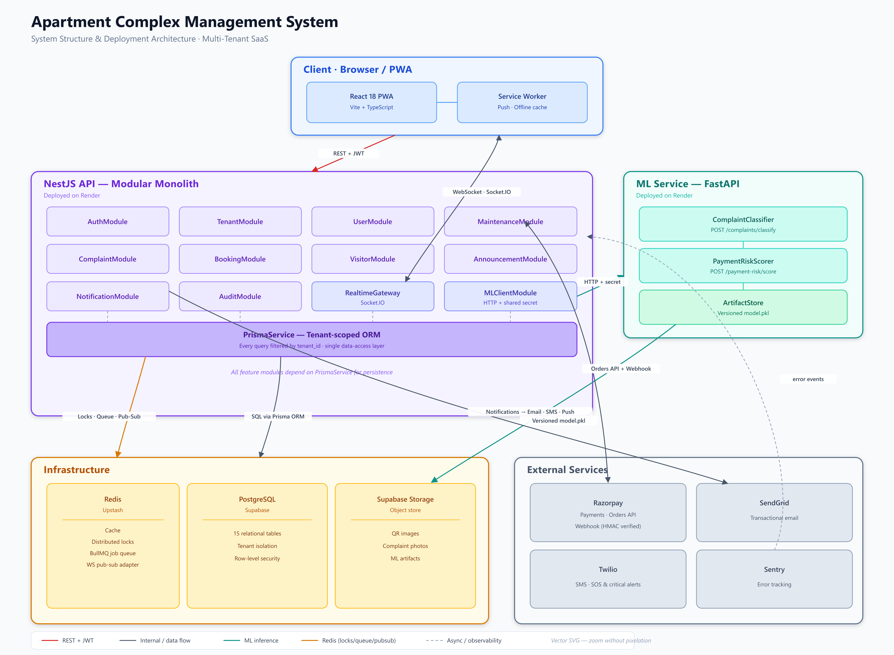
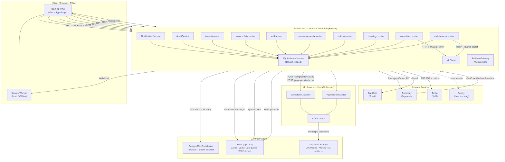
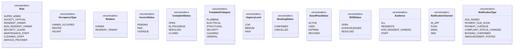
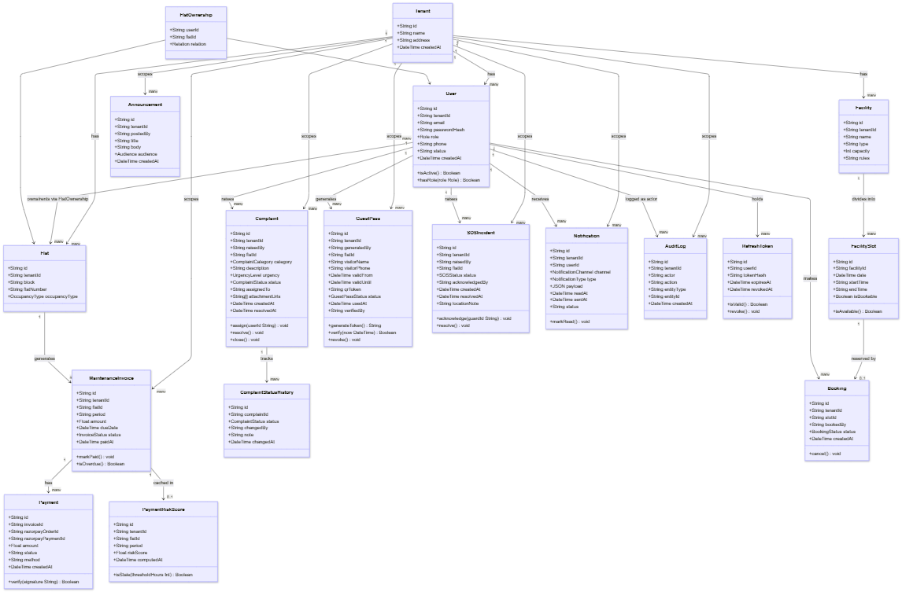
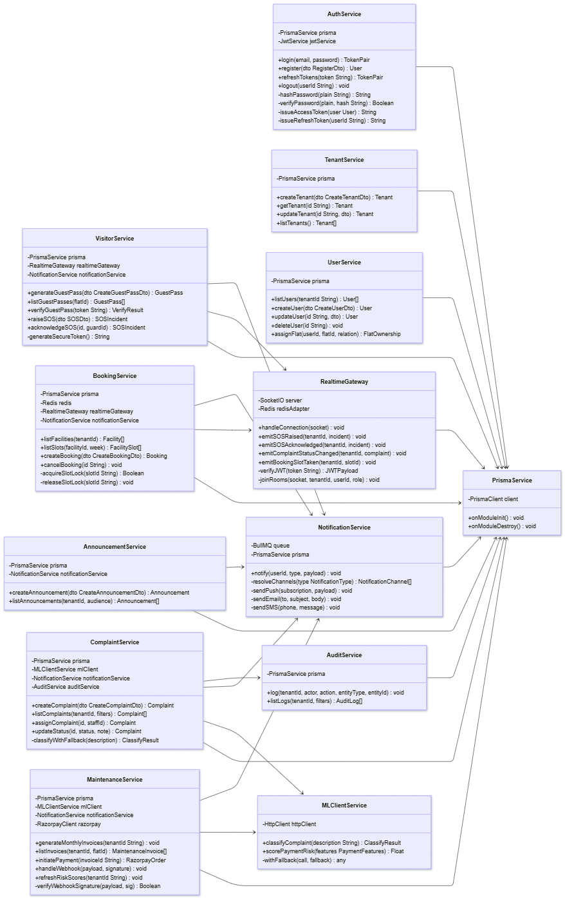
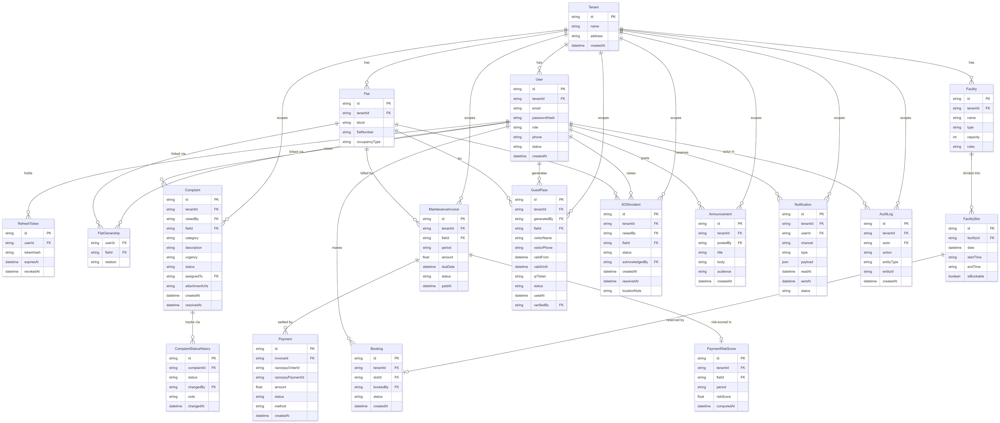

# Meridian — Final Project Report

**Apartment Complex Management System**

Team 98 · IITM BS Degree, Software Engineering · May 2026 term

Repository: <https://github.com/V47VANSH/MAY2026-Team-098>

---

## Table of Contents

1. [Executive Summary](#1-executive-summary)
2. [Team and Contributions](#2-team-and-contributions)
3. [Part A — Requirements and Design](#part-a--requirements-and-design)
4. [Part B — Implementation](#part-b--implementation)
5. [Part C — Testing and Quality](#part-c--testing-and-quality)
6. [Part D — Tools and Technologies](#part-d--tools-and-technologies)
7. [Part E — Code Review, Issue Reporting and Tracking](#part-e--code-review-issue-reporting-and-tracking)
8. [Part F — Instructions to Run the Application](#part-f--instructions-to-run-the-application)
9. [Part G — Design Evolution and Deviations](#part-g--design-evolution-and-deviations)
10. [Part H — Hosting](#part-h--hosting)
11. [Part I — Limitations and Future Work](#part-i--limitations-and-future-work)

---

## 1. Executive Summary

Meridian is a platform for running an apartment society. It replaces the
spreadsheets, WhatsApp groups and paper registers that societies typically use
with a single system covering maintenance billing and payment, complaint
management, shared-facility booking, visitor and emergency handling, society
communication, and remote oversight for owners who do not live on site.

**The product decision that shaped everything else** was to build it as
**multi-tenant SaaS** rather than for one society. One deployment serves many
societies, each isolated by `tenant_id`. This was a deliberate expansion beyond
the literal Milestone 1 brief, taken because it is a materially stronger
engineering problem — tenant isolation, scope derived from token claims, a
platform-level admin tier — without meaningfully increasing feature-build time,
and because it matches the shape of real PropTech products. The isolation
guarantee is enforced by a dedicated test suite that attempts every cross-society
access path with a token belonging to a different society, so it holds by test
rather than by convention.

**What was delivered:**

| | |
|---|---|
| Backend | FastAPI, 9 routers, **48 API paths / 59 operations / 62 schemas** |
| API contract | OpenAPI 3.1 generated from the live route table, with 24 user stories machine-mapped to endpoints and 44 error codes catalogued |
| Database | 18 tables, 13 indexes, Alembic migrations |
| Frontend | React + TypeScript SPA, every screen rendering from the real API |
| ML | Separate FastAPI service: complaint classifier and payment-risk scorer, both trained |
| Tests | **149 backend + 21 ML service**, all passing (7 further backend tests run only against a live Redis) |
| CI | Three GitHub Actions workflows: lint, typecheck, test, and contract-drift gates |

All six Milestone 1 epics are implemented end to end. The system runs from a
clone with no external service, no database server and no credentials: SQLite is
the default and seeds a demo society on first start.

---

## 2. Team and Contributions

| Contributor | Commits | Primary area |
|---|---|---|
| Tushar (`23f2003751`) | 40 | Backend APIs, ML service, API integration, testing, CI |
| *«name»* (`21f3000278`) | 7 | Frontend — official dashboard, Meridian AI assistant |
| Vansh Bansal | 5 | Repository setup, frontend |
| *«name»* (`21f1004124`) | 4 | Frontend pages |

> **Before submitting:** replace the two *«name»* placeholders above. Git records
> only the roll numbers for those accounts, and named ownership is what the
> teamwork criterion looks for.

**56 commits across 9 branches.** Ownership was organised horizontally — one
person per layer — which the team chose deliberately so that each member worked
across all six epics rather than owning one vertical slice. The consequence is
that every feature touches several people at once, and the OpenAPI contract is
what keeps them unblocked: the backend publishes the contract, the frontend
generates its types from it, and CI fails if the two drift apart.

---

# Part A — Requirements and Design

## A1. Problem and objective

Apartment societies coordinate maintenance collection, complaints, shared
facilities, visitors and emergencies through manual and semi-manual processes.
The concrete pain points identified in Milestone 1 user research were: no
visibility into what is owed and whether it was received; complaints raised
verbally with no trace and no accountability; double-booked facilities; visitors
admitted on the strength of a phone call; and owners living elsewhere having no
way to see any of it.

The objective is a centralised platform that makes each of these auditable and
visible to the people affected.

## A2. Users and roles

Nine roles across four tiers. Visitors are deliberately **not** accounts — they
hold a signed, time-boxed, single-use pass token, which keeps the auth model
simple while still giving a guard something cryptographically verifiable.

| Tier | Role | Core capabilities |
|---|---|---|
| Primary | `RESIDENT_OWNER` | Pay maintenance, raise complaints, book facilities, issue guest passes, raise SOS |
| Primary | `SOCIETY_OFFICIAL` | Manage residents, invoices, complaint triage, bookings, announcements |
| Secondary | `NON_RESIDENT_OWNER` | Track dues and complaints remotely, issue guest passes, read announcements |
| Secondary | Visitor | Holds a guest pass — not an account |
| Tertiary | `SECURITY_GUARD` | Verify guest passes, receive and acknowledge SOS |
| Tertiary | `MAINTENANCE_STAFF` / `CLEANING_STAFF` | Receive and resolve assigned complaints |
| Tertiary | `SERVICE_PROVIDER` | Fulfil service requests |
| Platform | `SUPER_ADMIN` | Onboard and manage societies |

## A3. Epics and user stories

**24 user stories across 6 epics.** These are not merely listed in a document —
they are embedded in the published API contract as an `x-user-story-mapping`
extension, so every story names the endpoints that implement it and the mapping
travels with the spec.

| Epic | Stories | Router |
|---|---|---|
| E1 — Maintenance Management | 4 | `maintenance.py` |
| E2 — Complaint Management | 4 | `complaints.py` |
| E3 — Facility Management | 4 | `bookings.py` |
| E4 — Visitor & Emergency Management | 5 | `visitors.py` |
| E5 — Society Administration | 4 | `announcements.py`, `tenants.py` |
| E6 — Non-Resident Owner Services | 3 | cross-cutting, role-gated |

Example, verbatim from `backend/openapi.yaml`:

> **US-1.1** — *As a resident, I want to see my maintenance dues so that I know
> what I owe and by when.*
> → `GET /api/v1/maintenance/invoices`, `GET /api/v1/maintenance/invoices/{invoice_id}`,
> `GET /api/v1/maintenance/payments/{payment_id}`

## A4. Architecture

A **modular monolith** for the API — one router per epic — plus a separately
deployable ML service. Not microservices: at a five-person scale, one router per
epic gives the same separation of concerns without the operational cost of
independent deployables. The ML service is the one exception, because one member
owns both models end to end and needs to iterate on them without touching API
release cycles.





Full detail: [00 — Architecture Overview](00-architecture-overview.md),
[07 — Component Design](07-component-design.md).

## A5. Wireframes and workflow

Screen-by-screen wireframes, the role-based sitemap, and the end-to-end workflow
for each epic are in [06 — Wireframes and Workflow](06-wireframes-and-workflow.md).

## A6. Class and domain design







Full detail: [08 — Class Diagram](08-class-diagram.md).

## A7. Database design

18 tables. Every tenant-scoped table carries `tenant_id`, and every composite
index leads with it.



Full detail: [09 — Database Design](09-database-design.md),
[03 — Database Architecture](03-database-architecture.md).

---

# Part B — Implementation

## B1. Frontend

React 18 + TypeScript on Vite. Two state systems with a deliberate split:
**Zustand** holds session state (the signed-in user and their tokens), **TanStack
Query** holds server state. They are not interchangeable — server state needs
caching, refetching and invalidation, session state needs none of that and must
be readable outside React by the API client.

The API client (`src/api/client.ts`) is the single place the frontend talks to
the backend. It attaches the bearer token, unwraps the uniform error body into a
typed `ApiError`, and transparently refreshes an expired access token before
replaying the request. That refresh is single-flight: several queries commonly
fail with 401 in the same tick, and because the backend revokes a refresh token
as it rotates it, letting each one refresh independently would log the user out.

Request and response types are **generated** from the backend's published spec,
not written by hand. CI regenerates them and fails if they differ from what is
committed.

Full detail: [01 — Frontend Architecture](01-frontend-architecture.md).

## B2. Backend

One `api/v1/*.py` router per epic, wired with `APIRouter` and `Depends()` rather
than a global container — so a route's authentication, role and tenant
requirements are readable directly from its signature.

Full detail: [02 — Backend Architecture](02-backend-architecture.md).

## B3. API contract

FastAPI generates OpenAPI 3.1 from the Pydantic models on every route, served at
`/api/docs` and exported to `backend/openapi.yaml`. Because it is generated from
the live route table, it cannot describe an endpoint that does not exist. CI
enforces the converse by re-exporting and failing on any diff, so a route cannot
be added without the contract following it.

Two extensions beyond standard OpenAPI:

| Extension | Contents |
|---|---|
| `x-user-story-mapping` | 6 epics, 24 stories, each naming its endpoints |
| `x-error-catalogue` | 44 error codes with status and meaning |

## B4. Security

| Concern | Implementation |
|---|---|
| Access tokens | JWT HS256, 15-minute expiry |
| Refresh tokens | **Rotating** — presenting one issues a new pair and revokes the presented one, so a stolen token is usable at most once and its reuse is detectable. Only the SHA-256 hash is stored, so a database leak yields no usable tokens |
| Passwords | PBKDF2-SHA256, 260,000 iterations, per-user salt, iteration count embedded in the digest so the cost can be raised later without invalidating existing passwords |
| Authorisation | `require_roles(...)` dependency reading the token's role claim |
| Tenant scope | `get_tenant_id` reads the token claim **only** — never a body or query parameter, so a caller cannot ask for another society's data |
| Guest passes | 192-bit random token (not sequential, so passes cannot be enumerated), single-use: the `ACTIVE → USED` flip happens in the same transaction that returns the verification result, which is what defeats replay of a captured QR image |
| Payments | HMAC-SHA256 over `<order_id>\|<payment_id>` verified **before** anything in the payload is trusted |

Two deliberate choices worth noting: cross-tenant reads return **404, not 403**,
because confirming a record exists would leak that another society holds that id;
and login returns an identical error for an unknown email and a wrong password, so
the response cannot be used to enumerate registered addresses.

**Rate limiting.** Fixed-window, keyed on client IP, with tighter ceilings on
`/auth/*` (20/min) and `/sos` (10/min) than on general traffic (240/min). The
reason differs per endpoint: `/auth` is where credential stuffing and email
enumeration are attempted, and `/sos` fans out to every guard in the society over
push and SMS, so a loop on it is both a cost and an alert-fatigue problem.

A fixed window admits a burst spanning a boundary — up to twice the limit across
two adjacent windows. That is a real weakness, accepted because it costs one
`INCR` against Redis where a sliding-window log costs a sorted-set write plus a
trim, and the threat here is a sustained loop rather than a precisely timed
burst.

`X-Forwarded-For` is believed only behind a proxy explicitly marked trusted.
A client can set that header themselves, so trusting it unconditionally would let
anyone reset their own counter by varying it — the control would look present and
do nothing.

## B5. Epic flows

**Maintenance and payments.** `(tenant_id, flat_id, period)` is unique, so
re-running billing cannot double-charge. Pay Now creates a gateway order and a
`CREATED` payment row; the invoice only flips to `PAID` on a signature-verified
confirmation. Overdue status is recomputed **on read**, so an unpaid invoice past
its due date reports `OVERDUE` without depending on a nightly job having run — and
that transition is also the moment the flat's occupants are notified.

**Complaints.** Free text goes to the ML classifier; if it is unavailable, slow,
or below the confidence threshold, a deterministic keyword classifier answers
instead and the complaint is flagged `needs_manual_triage`. **Submission never
depends on ML being up.** Status transitions are validated against the lifecycle
(`OPEN → IN_PROGRESS → RESOLVED → CLOSED`); a complaint cannot jump from `OPEN`
straight to `RESOLVED`, because the intermediate state is what makes the audit
trail meaningful. Where staff fix something on the spot, a one-tap action issues
both transitions rather than short-cutting the lifecycle.

**Bookings — race safety.** Double-booking was the concrete failure mode named in
Milestone 1. It is defended twice: a per-slot lock serialises concurrent requests,
and a **partial unique index** on `slot_id WHERE status = 'CONFIRMED'` makes a
second confirmed booking impossible at the database level even if the lock were
bypassed by another process. The index is partial so that cancelling frees the
slot. Tested with eight genuinely simultaneous threaded requests.

**Visitors and emergency.** Guest pass tokens are returned only to the resident
who created the pass — list views omit them, because a list is not where a secret
belongs. Validity is evaluated on read on both the verify and list paths. SOS
writes the incident row **first**, then notifies, so the alert survives even if
every notification channel fails; a guard acknowledging it notifies the raiser
back, which is what turns a fire-and-forget button into a two-way exchange.

## B6. Error handling

Every failure — application errors, framework 404s, validation failures, and
unhandled exceptions — maps to one shape:

```json
{ "statusCode": 409, "error": "SLOT_ALREADY_BOOKED",
  "message": "This slot has already been booked", "requestId": "..." }
```

`error` is a stable machine-readable code the frontend branches on; `message` is
prose that may be reworded without breaking clients. `requestId` is generated per
request, returned in `X-Request-Id`, and included in the error body — so a
user-reported bug traces to its exact server-side log entry. The frontend surfaces
it on error screens. The catch-all handler never leaks a stack trace.

## B7. Database and migrations

Enums are stored as `VARCHAR` with a `CHECK` constraint rather than native
Postgres enum types, which keeps values readable in the database and avoids the
migration cost of altering an enum.

Schema has two paths, deliberately: local runs and the test suite build it
straight from model metadata so the project clones and runs with no database
server, while Postgres is migrated with `alembic upgrade head`. Two paths can
drift, so `tests/test_migrations.py` builds both and compares them structurally —
columns, foreign keys, indexes and CHECK constraints. A model change committed
without a matching revision fails there rather than on deploy.

## B8. ML service

Two models, one deployable, called by the backend over HTTP with a shared-secret
header.

**Complaint classifier** — TF-IDF over word unigrams and bigrams into logistic
regression, one model per output (category and urgency). Bigrams earn their place:
*"not urgent"* and *"no water"* both invert what their individual words suggest.
Trained on 107 hand-written seed phrases expanded by openers, locations and
urgency cues into ~2,650 labelled examples.

**Payment risk** — gradient-boosted trees over five features (`past_late_count`,
`avg_days_late`, `current_dues_amount`, `tenure_months`, `month`), computed by the
backend from invoice history and passed in the request body; the ML service is
stateless and never queries the database.

| Model | Metric | Floor |
|---|---|---|
| Complaint category | macro-F1 **1.0** | 0.85 |
| Complaint urgency | macro-F1 **0.9907** | 0.60 |
| Payment risk | ROC-AUC **0.6684** | 0.65 |

**These numbers need reading carefully, and we would rather say so than let them
be misread.**

The classifier's macro-F1 of 1.0 is not a generalisation estimate. Its training
and test data are generated from the same phrase templates, so that figure largely
measures the templates. The meaningful test uses phrasings written nowhere in the
training set: the model initially got 4 of 6, and — importantly — returned
confidence 0.30 and 0.39 on the two it missed, **below the backend's 0.55
threshold**, so the backend discarded them and flagged the complaints for manual
triage. Broadening the seed vocabulary fixed those two. The test now asserts the
property that actually matters: *never confidently wrong*, rather than never wrong.
A wrong-but-confident answer is the only genuinely damaging outcome, because it
routes a complaint to the wrong trade without flagging it.

The risk model's ROC-AUC of 0.6684 looks poor until measured against the
**Bayes-optimal 0.6818** for its own generative process — it reaches 98% of what
is achievable. Outcomes are sampled from a probability, so most of the remaining
gap is irreducible noise rather than a modelling failure. The trainer records both
numbers so the headline is not read out of context. An earlier floor of 0.75 was
unreachable by construction and was corrected to 0.65.

Both models are trained on **bootstrapped and simulated data**. Retraining on real
complaint text and real invoice history is what would turn them into evidence.

Full detail: [04 — ML Architecture](04-ml-architecture.md).

## B9. GenAI integration — the Meridian AI assistant

`POST /api/v1/ai/assistant` accepts natural language and returns a reply plus a
structured intent. Backed by **Google Gemini** when `GEMINI_API_KEY` is set, and by
rule-based intent matching when it is not — either way it classifies the request.

The assistant's job is working out what someone wants; the screens already do the
work. It maps the returned intent to the route that handles it, per role, and
hands the user there. An intent a role has no screen for produces no link rather
than one that bounces off a route guard.

*(This feature post-dates the Milestone 2 design documents and appears in none of
them; it is documented here.)*

## B10. Dashboard aggregation

Three role-scoped endpoints (`/dashboard/resident`, `/official`, `/non-resident`)
each replace the four or five calls a dashboard would otherwise fan out, with the
server doing the joining — so the counts on a dashboard cannot drift from the
lists they summarise. *(Also added after Milestone 2 and documented here.)*

---

# Part C — Testing and Quality

## C1. Strategy

`pytest` with FastAPI's `TestClient`, one suite per router. **Each test runs
against its own throwaway SQLite database**, so tests share no state and run in
any order — no PostgreSQL, no Redis, no running server. This is what makes the
suite runnable by a grader with a fresh clone and nothing installed.

## C2. Current results

```
$ cd backend && pytest -q
149 passed, 7 skipped

$ cd ml-service && pytest -q
21 passed

$ cd backend && ruff check .
All checks passed!

$ cd frontend && npm run typecheck
(clean)
```

Backend coverage by module: `test_ai` 7, `test_announcements` 10, `test_auth` 14,
`test_bookings` 13, `test_complaints` 17, `test_maintenance` 19,
`test_migrations` 5, `test_missing_apis` 9, `test_rate_limit` 9,
`test_redis_paths` 9, `test_tenant_isolation` 9, `test_user_management` 9,
`test_visitors` 19.

The 7 skipped are `test_redis_integration`, which exercises the same guarantees
against a **live** Redis rather than a fake. They skip when no Redis is
configured — which keeps the suite runnable with nothing installed — and run in
CI against a `redis:7` service container. The distinction matters: a fake proves
the code issues the commands it intends to, but only a real server can prove
that `SET NX PX` is genuinely atomic and that the release script really is
compare-and-delete.

## C3. Tests that check properties, not endpoints

Three suites are worth reading before the rest, because they assert guarantees
rather than responses:

| Suite | Guarantee |
|---|---|
| `test_tenant_isolation.py` | Every cross-society access path, attempted with a token from a *different* society — the realistic shape of the attack |
| `test_bookings.py` | Eight simultaneous threaded booking requests for one slot produce exactly one `201` and seven `409`s |
| `test_migrations.py` | The Alembic revisions and the ORM models build structurally identical schemas |

## C4. Functional test cases

Ten fully documented cases — API, inputs, expected output, actual output,
pass/fail — are in [10 — Milestone 3 Report §4](10-milestone-3-report.md#4-api-test-cases),
covering registration, wrong-password login, single-use refresh tokens, forged
payment signatures, duplicate invoices, complaint auto-classification, illegal
status transitions, the concurrent-booking race, guest-pass reuse, and
cross-society reads.

## C5. The defect our testing found — TC-11

Testing surfaced a genuine defect, which we documented rather than quietly fixed:
**an expired guest pass was still listed as `ACTIVE`.** The validity window was
evaluated on the verify path but not on the list path, so a pass whose window had
closed stayed listed as active until someone scanned it. There was no security
impact — the gate refused it either way — but the resident's list was misleading.

It was recorded with root cause and impact in
[10 §5](10-milestone-3-report.md#5-test-case-where-expected-and-actual-output-do-not-match),
held under a `strict=True` `xfail` marker so that fixing it without removing the
marker would fail the build, scheduled as Sprint 5 Priority 1, and **resolved** by
applying the same read-time evaluation on both paths. The marker is gone and the
case is now a passing positive assertion.

That full loop — found by testing → documented with root cause → tracked →
scheduled → fixed → verified — is the single clearest piece of evidence of the
team's quality process, which is why the original record is preserved unedited.

---

# Part D — Tools and Technologies

## D1. Frontend

| Tool | Version | Purpose |
|---|---|---|
| React | 18.3.1 | UI framework |
| React DOM | 18.3.1 | DOM renderer |
| TypeScript | 5.5.4 | Static typing across the whole app |
| Vite | 5.3.5 | Dev server and production bundler |
| `@vitejs/plugin-react` | 4.3.1 | React fast-refresh |
| React Router DOM | 6.26.0 | Routing and role-based route guards |
| Zustand | 4.5.4 | Session state, readable outside React by the API client |
| TanStack React Query | 5.101.4 | Server state, caching, invalidation on write |
| Tailwind CSS | 3.4.7 | Styling |
| PostCSS / Autoprefixer | 8.4.40 / 10.4.19 | CSS pipeline |
| **openapi-typescript** | 7.13.0 | **Generates request/response types from the backend spec** |
| qrcode | 1.5.4 | Scannable guest-pass QR rendering |

## D2. Backend

| Tool | Version | Purpose |
|---|---|---|
| Python | 3.11+ (verified 3.13.1) | Language |
| FastAPI | 0.115.6 | Web framework; generates the OpenAPI contract |
| Uvicorn | 0.34.0 | ASGI server |
| SQLAlchemy | 2.0.36 | Typed ORM |
| **Alembic** | 1.14.0 | Versioned schema migrations |
| Pydantic | 2.10.4 | Request/response validation |
| pydantic-settings | 2.7.0 | Environment-driven configuration |
| PyJWT | 2.10.1 | HS256 access and refresh tokens |
| passlib | 1.7.4 | PBKDF2-SHA256 password hashing |
| email-validator | 2.2.0 | Email field validation |
| python-multipart | 0.0.20 | Form parsing |
| PyYAML | 6.0.2 | OpenAPI export |
| httpx | 0.28.1 | HTTP client |

## D3. ML service

| Tool | Version | Purpose |
|---|---|---|
| scikit-learn | 1.6.0 | TF-IDF + LogisticRegression; GradientBoostingClassifier |
| joblib | 1.4.2 | Model artifact persistence (`model.pkl`) |
| FastAPI / Uvicorn / Pydantic | as above | Service and contract |

## D4. Data

| Tool | Purpose |
|---|---|
| SQLite | Zero-configuration default; seeds a demo society on first run |
| PostgreSQL | Production path via `DATABASE_URL`; migrations exercised in CI |

## D5. External APIs

| Service | Mode | Usage |
|---|---|---|
| **Razorpay** | Test / sandbox | Order creation and HMAC-SHA256 signature verification before an invoice is settled |
| **Google Gemini** | `gemini-2.5-flash` | Natural-language assistant, with rule-based fallback |

## D6. Testing and quality

| Tool | Purpose |
|---|---|
| pytest 8.3.4 | 149 backend + 21 ML tests |
| FastAPI `TestClient` | In-process integration testing |
| Python `threading` | Genuine concurrency test for the booking race |
| **Ruff** | Backend and ML lint gate |
| `tsc --noEmit` | Frontend type gate |

## D7. API contract and documentation

OpenAPI 3.1 · Swagger UI (`/api/docs`) · ReDoc (`/api/redoc`) ·
`scripts/export_openapi.py` · `x-user-story-mapping` · `x-error-catalogue`

## D8. DevOps and collaboration

| Tool | Purpose |
|---|---|
| Git / GitHub | Version control, pull requests, code review |
| **GitHub Actions** | `ci-backend.yml`, `ci-frontend.yml`, `ci-ml.yml` |
| **Jira** | Issue tracking (SCRUM board) |
| `.env.example` | Committed configuration templates for backend and frontend |

## D9. Design and modelling

ERD (`db-design.svg`), class diagram, domain-entity diagram, service-class and
service-relationship diagrams, system-level component diagram, architecture
structure diagram, and an **interactive diagram viewer**
(`docs/architecture-diagram-viewer.html`).

## D10. Why these choices

**Python across backend and ML.** The ML service had to be Python. Making the API
Python too means one language across both services rather than two, and makes the
backend directly testable with `pytest` — the tool the milestone deliverables are
graded with.

**FastAPI over Flask.** The OpenAPI contract is generated from the route
definitions themselves, which is what makes contract-first collaboration between
the frontend and backend owners possible without a hand-maintained spec drifting.

**SQLite by default.** The submission must run for a grader with no database
server. PostgreSQL remains one environment variable away and is exercised in CI.

**Multi-tenant from the start.** Retrofitting tenant isolation is far harder than
building with it.

---

# Part E — Code Review, Issue Reporting and Tracking

## E1. Process

```
Jira issue (SCRUM-xx)
   → feature branch
      → commits referencing the issue id
         → pull request
            → CI gates: ruff · pytest · tsc · contract-drift checks
               → peer review and approval
                  → merge to main
```

`main` is the always-runnable branch. Work happens on feature branches and reaches
`main` only through a reviewed pull request that CI has passed.

## E2. Tools

**Jira** for issue tracking (SCRUM board, sprint planning, burndown).
**GitHub** for code review via pull requests. **GitHub Actions** as the automated
first-pass reviewer — lint, tests, typecheck and contract-drift run before a human
looks at the diff.

## E3. Traceability — Jira issue to commit

Thirteen commits carry their Jira issue id in the subject line, giving a direct
trace from a board item to the code that implemented it:

| Jira | Commit | Date | Author | Subject |
|---|---|---|---|---|
| SCRUM-18 | `084129f` | 2026-07-14 | 21f3000278 | Improved society official dashboard and UX improvements |
| SCRUM-24 | `5c16820` | 2026-08-02 | Tushar | Identify APIs from user stories |
| SCRUM-25 | `9b36016` | 2026-08-02 | Tushar | Define endpoints, inputs, and outputs |
| SCRUM-25 | `30a448d` | 2026-08-02 | Tushar | Align design docs and diagrams with the implemented FastAPI stack |
| SCRUM-26 | `99434df` | 2026-08-02 | Tushar | Create Swagger-compatible YAML documentation |
| SCRUM-27 | `177d230` | 2026-08-02 | Tushar | Implement backend API endpoints |
| SCRUM-28 | `978bc65` | 2026-08-02 | Tushar | Add validation and error handling |
| SCRUM-29 | `eee99fe` | 2026-08-02 | Tushar | Integrate external / GenAI APIs |
| SCRUM-30 | `4ab8684` | 2026-08-02 | Tushar | Design functional API test cases |
| SCRUM-31 | `fac1bfb` | 2026-08-02 | Tushar | Compare expected vs actual outputs |
| SCRUM-32 | `735d6a0` | 2026-08-02 | Tushar | Implement pytest unit tests |
| SCRUM-33 | `ed06ed2` | 2026-08-02 | Tushar | Demonstrate features to users and collect feedback |
| SCRUM-46 | `0f2f30f` | 2026-07-14 | 21f3000278 | Implement Meridian AI |

## E4. Branch inventory

| Branch | Purpose |
|---|---|
| `main` | Always-runnable trunk |
| `UI-V1`, `UI-V2` | Two iterations of the interface |
| `sprint4` | Sprint 4 backend work |
| `feature/api-integration` | Frontend wired to the live API |
| `feature/Dashboard-improvements` | Official dashboard rework |
| `feature/Meridian-AI` | GenAI assistant |
| `feature/Additional-API` | Sprint 5 backend and integration |
| `docs/final-submission-alignment` | Final submission documentation |

## E5. Project chronology

| Date | Activity |
|---|---|
| 5–14 Jul | Repository setup, UI iterations, official dashboard, Meridian AI |
| 2 Aug | **Sprint 4** — SCRUM-24 → 33: API design, implementation, YAML, test cases, pytest, user feedback |
| 9–12 Aug | Dashboard improvements, API integration groundwork |
| 21–23 Aug | **Sprint 5** — full frontend/API integration, ML service, Alembic, CI, doc alignment |

## E6. Defect lifecycle — a worked example

The TC-11 guest-pass defect (Part C5) is the process working end to end:

| Stage | Evidence |
|---|---|
| Found | User-testing feedback item 7 and the API test suite |
| Reported | Documented with root cause, impact and reproduction in `docs/10` §5 |
| Tracked | Held under a `strict=True` `xfail` so it could not be silently fixed |
| Planned | Scheduled as Sprint 5 Priority 1 in `docs/10` §7 |
| Fixed | Read-time window evaluation applied on the list path |
| Verified | Marker removed; case now passes as a positive assertion; suite green |

## E7. User feedback and its effect

Seven feedback items were collected by demonstrating the working endpoints to
users ([10 §6](10-milestone-3-report.md#6-user-feedback)). Four confirmed existing
behaviour. One was **declined with a reasoned alternative**: an official asked to
skip `IN_PROGRESS` when staff fix something on the spot, and the team kept the
intermediate state because it is what makes the audit trail meaningful, delivering
a one-tap UI action that issues both transitions instead. One became a new filter
(`?needs_triage=true`). One was confirmed as the TC-11 defect above. All three
accepted items were delivered in Sprint 5.

## E8. Screenshots

> *Insert here:* Jira board and backlog · sprint list with dates · burndown or
> velocity chart · 2–3 issue detail pages showing the Activity/History tab
> (SCRUM-31 and SCRUM-32 are the most illustrative) · sprint report · GitHub pull
> requests with their review threads · branch list · Actions tab showing green
> runs · Insights/Contributors graph.

---

# Part F — Instructions to Run the Application

## F1. Prerequisites

- **Node.js 18+** and npm
- **Python 3.11+**

Verified on Python 3.13.1, Node 22.12.0, npm 11.7.0.

No database server, message broker or cloud account is required.

## F2. Backend (start this first)

**Windows**

```bat
cd backend
python -m venv .venv
.venv\Scripts\activate
pip install -r requirements.txt
uvicorn app.main:app --reload
```

**Ubuntu / macOS**

```bash
cd backend
python3 -m venv .venv
source .venv/bin/activate
pip3 install -r requirements.txt
uvicorn app.main:app --reload
```

The API starts on <http://localhost:8000>. On first run it creates
`backend/acms.db` and seeds a demo society — nothing else to install.

| URL | What it is |
|---|---|
| <http://localhost:8000/api/docs> | Interactive Swagger UI |
| <http://localhost:8000/api/redoc> | ReDoc reference |
| <http://localhost:8000/api/openapi.json> | Machine-readable spec |
| <http://localhost:8000/health> | Liveness probe |

## F3. Frontend

In a second terminal:

```bash
cd frontend
npm install
npm run dev
```

Open <http://localhost:5173>. Requests to `/api` are proxied to the backend, so
the browser only ever talks to one origin and no CORS configuration is needed.

## F4. ML service (optional)

Skip it and the application still works — complaint classification falls back to
the keyword classifier and flags each complaint for manual triage, which is the
designed behaviour rather than a failure.

```bash
cd ml-service
python -m venv .venv
.venv\Scripts\activate          # Windows
source .venv/bin/activate       # Ubuntu / macOS
pip install -r requirements.txt
uvicorn app.main:app --port 8100
```

Trained artifacts are committed, so it serves predictions immediately. To retrain:

```bash
python -m app.complaints.train
python -m app.payment_risk.train
```

Then point the backend at it and restart the backend:

```bat
set ML_SERVICE_URL=http://localhost:8100          :: Windows
export ML_SERVICE_URL=http://localhost:8100       # Ubuntu / macOS
```

## F5. Demo accounts

Every seeded account uses the password **`Password123`**. The sign-in page lists
them behind **Show demo accounts** and fills the form when one is clicked.

| Email | Role |
|---|---|
| `resident@greenvalley.example` | Resident / Flat Owner (flat B-304) |
| `official@greenvalley.example` | Society Official |
| `owner@greenvalley.example` | Non-Resident Owner |
| `guard@greenvalley.example` | Security Guard |
| `staff@greenvalley.example` | Maintenance / Cleaning Staff |
| `admin@platform.example` | Platform admin (API only) |

## F6. Running the tests

```bash
cd backend      && pytest        # 149 tests
cd ml-service   && pytest        # 21 tests
cd frontend     && npm run typecheck && npm run build
```

## F7. Verification of these instructions

These steps were not written from memory. They were verified on 23 Aug 2026 by
cloning `main` into an empty directory and following this section top to bottom on
fresh virtual environments:

| Step | Result |
|---|---|
| `git clone` → repository contents | `backend/`, `frontend/`, `ml-service/`, `docs/`, `.github/` present; no `.venv`, `node_modules` or database file |
| Backend: venv → `pip install -r requirements.txt` → `pytest` | **149 passed**, 7 skipped |
| Backend: `uvicorn app.main:app` | `/health` → `{"status":"ok"}`; `/api/docs` → 200; demo login → 200 |
| ML service: venv → install → `pytest` | **21 passed** |
| Frontend: `npm install` → `npm run typecheck` | Clean |
| Frontend: `npm run build` | Built in 23.6 s |
| Frontend: `npm run dev` → sign-in through the API proxy | 200 |

One thing to expect: the very first request through the Vite proxy immediately
after `npm run dev` can time out while the dev server finishes starting. A refresh
resolves it — it is a cold start, not a failure.

## F8. Two configuration caveats

**Online card payment needs real Razorpay credentials.** The backend verifies the
gateway's HMAC before settling an invoice — correctly, since otherwise any client
could mark an invoice paid for free. With the placeholder key the order is still
recorded and the resident is told online payment cannot complete, rather than
being shown a false receipt. The society official's **offline payment** path works
fully and is the one to use in a demo.

**The AI assistant** uses rule-based intent matching unless `GEMINI_API_KEY` is
set. Either way it classifies the request and links to the right screen.

---

# Part G — Design Evolution and Deviations

Where the delivered system differs from the Milestone 2 design, each difference is
a decision. The pattern in all of them is the same: **the feature degrades to a
working fallback rather than a missing capability.**

| Designed | Delivered | Why |
|---|---|---|
| Redis distributed lock for bookings | **Delivered**, with an in-process fallback | Redis is used when `REDIS_URL` is set and falls back otherwise. The fallback is not a lesser version of the same thing: an in-process lock serialises within one worker and does nothing across several, so what Redis buys is correctness across processes. Either way the partial unique index remains the actual guarantee |
| Rate limiting | **Delivered** | Fixed-window, per client IP, tighter on `/auth/*` and `/sos`. See B4 for the fixed-versus-sliding tradeoff and why `X-Forwarded-For` is only trusted behind a declared proxy |
| WebSocket gateway for live updates | Polling | Every REST endpoint behind the intended events exists and is tested. The transport is the only missing piece, and polling is correct if less elegant |
| Queued push/email/SMS dispatch | Channel routing implemented, logged at the dispatch boundary | Real delivery needs provider credentials. The in-app notification row is always written, so no notification is lost — only its external copy |
| Supabase Storage for attachments | Not built | Complaint photo upload is not implemented because there is no object store to put a file in. `attachment_urls` exists on the model but no endpoint writes to it |
| Entity methods on models (doc 08) | Behaviour in the router/service layer | The class diagram documents the conceptual model; the implementation keeps domain logic where the transaction boundary is. A deliberate anaemic-model choice, not an oversight |
| `Notification.payload` (JSON) | `title` + `body` columns | Every notification the system sends is a title and a body. A JSON column would have been unused generality |
| PWA and Sentry | Not built | Scope traded for depth in the delivered features. Listed in Part I |

Two of these moved during the final sprint. Rate limiting and the Redis-backed
lock were both documented as designed and were not implemented; both now are.
The Redis work is worth a note on how it was verified, because the tests found
two defects the implementation would otherwise have shipped with:

- Releasing the lock used Redis's `EVAL` unconditionally. Some managed Redis
  offerings disable scripting; the release then failed and the lock sat until its
  TTL expired, serialising every booking for that slot behind it. It now falls
  back to a read-then-delete, accepting a rare mistaken release because the
  database index is the real guarantee and a guaranteed stall is far worse.
- More seriously, a *contended* lock and an *unreachable* Redis were handled
  identically — both fell through to the in-process lock — so a request that lost
  the race barged into the critical section anyway. Two threads were measurably
  inside it at once. Contention now waits; unavailability falls back.

Neither would have been caught by testing against a fake alone, which is the
argument for the live-Redis suite described in C2.

---

# Part H — Hosting

The system is deployed to the topology
[05 — DevOps Architecture](05-devops-architecture.md) specifies:

| Component | Host | Notes |
|---|---|---|
| Frontend | **Vercel** | Root directory `frontend`, Vite preset |
| API | **Render** | Root directory `backend`, migrations run before the server starts |
| ML service | **Render** | Root directory `ml-service`; trained artifacts are committed, so there is no training step in the build |
| Database | **Supabase Postgres** | Connected through a pooler, not the direct endpoint |
| Redis | **Upstash** | Optional; backs the booking lock and rate limiter |

`render.yaml` and `frontend/vercel.json` are committed, and
[`DEPLOYMENT.md`](../DEPLOYMENT.md) is a standalone walkthrough. Everything below
is a decision the deployment forced, and each is the kind of thing that fails
quietly rather than loudly.

**The frontend proxies rather than calling the API directly.** Vercel rewrites
`/api/*` to Render, so the browser stays same-origin in production exactly as it
does behind the Vite dev proxy locally. CORS is therefore never exercised in
either environment, and no API URL is compiled into the JavaScript bundle — the
same build artifact works against any backend.

**Schema ownership had to be made explicit.** Startup called `create_all`
unconditionally, which is right for SQLite and wrong for a database Alembic
manages: it would create tables with no revision stamp, and the next `upgrade`
would fail on tables that already exist. `AUTO_CREATE_TABLES` now defaults to
true for SQLite and false otherwise, so local runs stay zero-setup and migrations
own everything else.

**Prepared statements are disabled against Postgres.** Supabase's transaction
pooler hands out a backend per transaction, so a statement psycopg prepared on
one may not exist on the next. That surfaces as intermittent errors, under load,
in production only, and never locally against SQLite — so it is turned off, which
costs a little planning time per query and makes either pooler mode correct.

**Free-tier instances sleep.** Render free services spin down after roughly
fifteen minutes idle, and the next request takes 30–50 seconds while the
container wakes. Worth stating plainly so it is not mistaken for a performance
defect during evaluation.

Alongside the hosting, three CI workflows gate every pull request on lint, tests,
typecheck, migration integrity and contract drift.

---

# Part I — Limitations and Future Work

Stated plainly, in the order we would tackle them. Nothing here is hidden
elsewhere in the report — an undisclosed gap is worth less than a disclosed one,
because a reader who finds one has to wonder what else there is.

1. **Frontend test suite.** There is none. `tsc --noEmit` is a real gate, but it
   is a type gate, not a behaviour gate — it cannot tell you a button stopped
   calling the right endpoint. Vitest and React Testing Library first, then
   Playwright for the six golden paths. This is the largest genuine hole in the
   quality story and the reason it sits at the top.
2. **Real notification delivery.** Channel routing is implemented and logged at
   the dispatch boundary, but nothing is sent. Wiring a push, email and SMS
   provider behind the existing `notify()` call, with a queue so a slow provider
   cannot affect a request.
3. **WebSocket gateway.** Replacing polling for SOS alerts and live booking-slot
   availability. Every REST endpoint behind the intended events already exists
   and is tested; only the transport is missing.
4. **ML on real data.** Both models are trained on bootstrapped and simulated
   data, and the reported metrics should be read as described in B8 rather than
   at face value. Retraining on accumulated complaint text and invoice history is
   what would turn them into evidence.
5. **Complaint photo upload.** `attachment_urls` exists on the model, but there
   is no object store behind it and no endpoint that writes to it. Needs Supabase
   Storage.
6. **PWA.** Installability, an offline app shell, and Web Push.
7. **Deployment hardening.** Migrations currently run in the start command;
   Render's dedicated pre-deploy step is the better home for them on a paid plan.
   Sentry for error tracking, and an uptime monitor.
8. **Smaller gaps.** An audit-log UI (the endpoint exists and nothing renders
   it), a camera QR scanner for guards (typing the token works today), and
   hold-to-trigger SOS to prevent accidental presses.

Two items that appeared on this list in earlier drafts — **rate limiting** and
the **Redis-backed booking lock** — were both closed in the final sprint and are
described in B4 and Part G.

---

## Appendix — Document index

| Document | Contents |
|---|---|
| [00 — Architecture Overview](00-architecture-overview.md) | System overview, roles, epic mapping, technology status |
| [01 — Frontend Architecture](01-frontend-architecture.md) | React app structure, state, API client |
| [02 — Backend Architecture](02-backend-architecture.md) | Routers, contract, security, per-epic flows, errors, testing |
| [03 — Database Architecture](03-database-architecture.md) | Tenant isolation, migrations, enums, seeding |
| [04 — ML Architecture](04-ml-architecture.md) | Both models, training, evaluation, fallbacks |
| [05 — DevOps Architecture](05-devops-architecture.md) | CI, environments, secrets, monitoring, hosting status |
| [06 — Wireframes and Workflow](06-wireframes-and-workflow.md) | Screens, sitemap, end-to-end flows |
| [07 — Component Design](07-component-design.md) | Component inventory and interactions |
| [08 — Class Diagram](08-class-diagram.md) | Domain and service class design |
| [09 — Database Design](09-database-design.md) | 18-table ERD, keys, constraints, indexes |
| [10 — Milestone 3 Report](10-milestone-3-report.md) | Sprint 4 record: API inventory, TC-01…TC-11, feedback, Sprint 5 plan |
| **11 — Final Report** | This document |
| [13 — Presentation](13-presentation.md) | Slide deck with speaker notes |
| [14 — Demo Script](14-demo-script.md) | Running order for the recorded demonstration |
